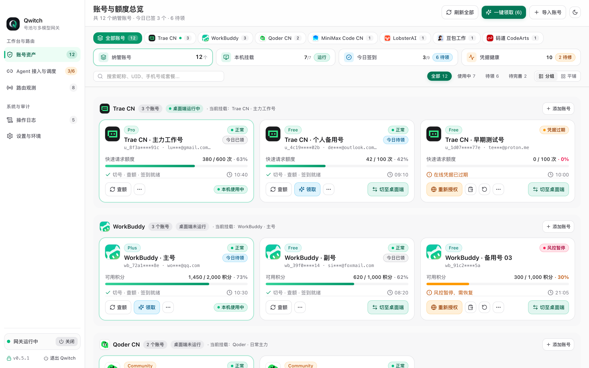
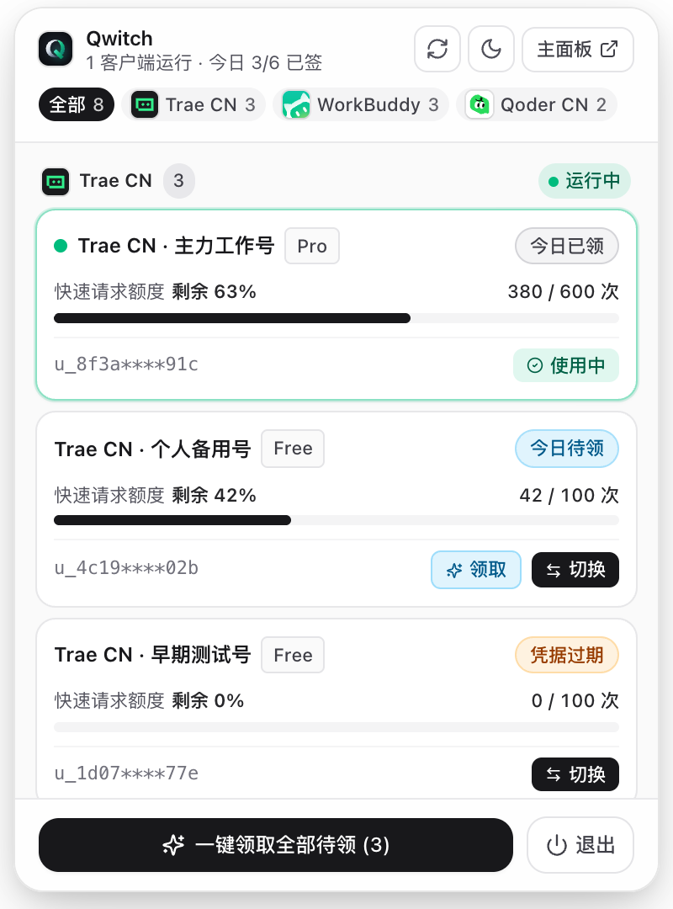

<div align="center">


# Qwitch

### 多个 AI 账号，一个本地入口。

查额度、领签到、切换桌面登录，再把订阅模型接进 Codex、Claude、OpenCode。<br>
账号、凭据和日志保存在本机，不上传到云端。

<sub>Qwitch is a local-first desktop app for managing multiple AI tool accounts and serving their subscription models through a local gateway.</sub>

[](https://github.com/LuckyOneTwoThree/Qwitch/releases/latest)
[](https://github.com/LuckyOneTwoThree/Qwitch/actions/workflows/ci.yml)
[](LICENSE)


**[下载](https://github.com/LuckyOneTwoThree/Qwitch/releases/latest)** · **[功能](#能做什么)** · **[支持的账号与 Agent](#支持的账号与-agent)** · **[安全与隐私](#安全与隐私)** · **[文档](#文档)** · **[问题反馈](https://github.com/LuckyOneTwoThree/Qwitch/issues)**

</div>

<picture>
  <source media="(prefers-color-scheme: dark)" srcset="docs/assets/screenshots/dashboard-dark.png">
  
</picture>

## Qwitch 适合你吗？

同一个 AI 工具开了多个账号，额度、签到和登录状态分散在不同地方；Codex、Claude、OpenCode 又各自需要一套配置。Qwitch 把这些事情放到一个桌面应用里：

- 在一个窗口里查看多个工具的账号、额度和签到状态。
- 需要时手动领取每日积分或 Credits，不用逐个打开客户端。
- 一键切换桌面客户端的登录账号，失败会回滚到原来的账号。
- 在本机启动一个模型网关，把已有订阅账号接到不同的 Agent。
- 修改 Agent 配置前先备份，随时可以还原。

它适合同时使用多个工具、多个账号，或者多个 Agent 的人。如果你只有一个账号、只用一个官方客户端，Qwitch 不会带来太多帮助。它也不提供云端同步、团队共享、远程访问网关或自动批量注册账号。

这里的 Agent 指 Codex 桌面版、Claude 桌面版、OpenCode、DeepSeek Harness、MiMo Code、ZCode 这类会调用模型的应用。

## 快速开始

**1. 安装。** 从 [Releases](https://github.com/LuckyOneTwoThree/Qwitch/releases/latest) 下载对应平台的安装包。macOS 选 Apple Silicon 或 Intel 版本，Windows 选 x64。

**2. 导入账号。** 打开「账号资产 → 导入账号」，选择工具。可以按提示用浏览器登录，也可以读取本机已登录的客户端，或直接粘贴登录令牌（Token）。

**3. 查看额度和签到。** 账号卡片会显示当前额度、套餐周期和今日签到状态。需要时点「领取」，或用顶部按钮批量查额、批量领取。

**4. 切换桌面账号。** 点卡片上的「切换」。Qwitch 会关闭客户端、备份当前登录、写入目标账号，再重新打开。过程中失败会自动恢复原账号。

**5. 接入 Agent（可选）。** 打开「Agent 接入与调度」，启动本地网关，选择要开放的模型，设置默认模型和主备顺序，然后重启对应的桌面客户端。网关默认关闭，需要你手动启动。

> macOS 安装包目前没有 Apple Developer 签名。首次打开如果被 Gatekeeper 拦截，按 [FAQ](#常见问题) 里的步骤放行。Windows 首次安装时 SmartScreen 可能提示，选择「更多信息 → 仍要运行」。

软件更新会在启动后查询 GitHub Releases。Windows 会下载 NSIS 安装包并校验 SHA256 后自动升级；macOS 会按架构下载 DMG，并给出 Gatekeeper 放行步骤。

## 支持的账号与 Agent

### 账号工具

Qwitch 目前内置 7 个账号适配器，另支持一个通用 API Key 作为最后兜底。

| 工具 | 额度与签到 | 导入方式 | 加入号池 |
| --- | --- | --- | --- |
| **Trae CN** | 额度与套餐；每日签到 Credits | 内置网页登录 / 本机读取 / Token | 支持 |
| **WorkBuddy** | 签到状态；每日签到与积分领取 | 内置登录 / 本机凭据 / Token | 支持 |
| **Qoder CN** | 活动 Credits；一键领取 | 本机读取 / 内置 PKCE 授权 / PAT | 支持 |
| **MiniMax Code CN** | 积分水位；每日签到 | 本机读取 / 内置设备码授权 / Token | 支持 |
| **LobsterAI（有道龙虾）** | 积分水位；每日签到 | 内置 OAuth 授权 / 本机读取 / Token | 支持 |
| **豆包工作** | 多类额度与额度包；每日签到 | 内置网页登录（Cookie） / 本机读取 / Cookie 或 cURL | 支持 |
| **码道 CodeArts** | 积分水位（华为云 AK/SK 签名） | 本机读取 / Token | 需单独授权 |
| **通用 API Key** | 不提供额度和签到 | 手动填写 Key 与 Base URL | 作为最后兜底 |

说明：

- 所有工具都支持一键切换桌面登录，码道 CodeArts 除外，它目前只做额度监控。
- Trae 和 Qoder 的国际版没有每日签到，暂未内置适配器。
- 码道 CodeArts 的 refreshToken 是一次性轮换的。Qwitch 默认只读，避免和官方 IDE 互相踢下线；要让它参与网关调度，需要在号池里单独完成一次 OAuth 授权。

### 接入的 Agent

Qwitch 可以写入 6 个桌面客户端的配置，另外提供通用 OpenAI / Anthropic 端点。

| Agent | 接口 | Qwitch 会做什么 |
| --- | --- | --- |
| **Codex 桌面版** | OpenAI Responses | 写入独立的 `qwitch` provider 和模型清单；没有匹配的模型时，仍走 Codex 自己的登录。 |
| **Claude 桌面版** | Anthropic Messages | 写入网关配置；非 Anthropic 模型会换成 `mythos-qwitch-*` 名称通过白名单；macOS 使用独立副本，不影响原客户端。 |
| **DeepSeek Harness (DSH)** | OpenAI Chat | 修改 profile 里的 `llm-pi-ai` 段和凭据文件，只动 Qwitch 自己写入的部分。 |
| **OpenCode** | OpenAI Chat | 写入 `opencode.jsonc` / `opencode.json` 的 provider，兼容 v1 和 v2 两种结构。 |
| **MiMo Code** | OpenAI Chat | 写入 `~/.mimocode/settings.json`，重启后生效。 |
| **ZCode** | Anthropic Messages | 写入 `~/.zcode/settings.json`，重启后生效。 |
| **通用端点** | OpenAI / Anthropic | 给出 `BASE_URL` 和 Key，供任意兼容客户端使用。 |

所有写入都会先做加密备份（Stash），修改前会显示配置差异。原文件解析失败时，Qwitch 会中止写入，不会用空配置覆盖你的文件。

<details>
<summary>各 Agent 的配置文件位置</summary>

| Agent | 文件 |
| --- | --- |
| Codex 桌面版 | `~/.codex/config.toml` + `~/.codex/qwitch_models.json` |
| Claude 桌面版 | `Claude/claude_desktop_config.json` + `Claude-3p/` |
| DeepSeek Harness | `~/.dsh/profiles/*/cordis.patch.yml` + `.env` + `.credentials.yaml` |
| OpenCode | `opencode.jsonc` / `opencode.json` |
| MiMo Code | `~/.mimocode/settings.json` |
| ZCode | `~/.zcode/settings.json` |

</details>

## 它怎么工作

Qwitch 由三部分组成。

**账号库。** 导入的账号、加密后的凭据、额度快照和操作日志保存在本机 SQLite 数据库。主密钥优先放在系统钥匙串，同时保留一份权限受限的备份，方便重装或迁移。

**本地网关。** 一个只监听 `127.0.0.1:8187` 的小服务，支持 OpenAI Chat、OpenAI Responses 和 Anthropic Messages 三种接口，并能在它们之间转换。Agent 把请求发给它，它按模型和号池规则选择一个账号，再转发到对应工具的上游。

**Agent 接入。** Qwitch 直接修改 Codex、Claude、DSH、OpenCode、MiMo、ZCode 的配置文件，把网关地址、令牌和模型清单写进去。修改前会备份，解绑时会还原。

```
Codex / Claude / DSH / OpenCode / MiMo / ZCode
                    │
                    │  OpenAI / Anthropic
                    ▼
        Qwitch 网关 127.0.0.1:8187
                    │
                    │  按模型和号池规则选择账号
                    ▼
  Trae CN · WorkBuddy · Qoder CN · MiniMax
  LobsterAI · 豆包工作 · 码道 CodeArts
```

网关只接受本机请求。每个 Agent 使用独立令牌，没有令牌或令牌不匹配会返回 401；浏览器发起的跨站请求也会被拒绝。

号池只会在同一个工具内部选账号。不同工具的模型不会互相顶替，请求也会锁定你选择的模型，不会偷偷换成别的模型。

## 能做什么

### 账号、额度和签到

- 查看每个账号的额度、套餐周期和签到状态，支持分组和平铺两种视图。
- 单卡查额、批量查额、单卡领取、批量领取，批量操作会显示进度和失败原因。
- 支持签到的工具会区分「可领 / 已领 / 待核实 / 不支持」，避免把不支持签到的账号算进待领。
- 操作日志记录每次查询、领取和切换，支持归档、恢复、筛选和导出，保留策略可配置。

### 切换桌面账号

切换过程是事务式的：关闭客户端，备份当前会话，写入目标账号，重新打开并确认存活。中途失败会恢复原来的会话。批量切号会串行执行，并加入随机等待，避免短时间内连续请求。

### 本地网关与号池

- 支持 OpenAI Chat、OpenAI Responses、Anthropic Messages，包含流式返回和工具调用。工具调用指 Agent 读写文件、执行命令时使用的那类请求。
- 同一个工具的多个账号可以组成号池，按主备顺序、剩余额度、单号耗尽或轮询选择。
- 主账号返回 429 时自动冷却并换下一个；401 时按账号刷新 Token 并写回加密库；可以配置一个通用 API Key 作为最后兜底。
- 同一会话会尽量留在同一个账号，利用上游的 Prompt Cache，也就是同一会话的缓存；可以跳过正在桌面端使用的账号，避免互相踢下线。

### Agent 接入与还原

- 按工具勾选要开放的模型，设置 `★` 默认模型和主备顺序，一次同步到所有已挂载的 Agent。
- 可以拉取上游真实模型目录，按「已勾选 / 免费低倍率 / 主力旗舰」筛选。
- 修改前显示配置差异，原文件加密备份；支持漂移检测、一键修复、解绑还原、按 Agent 或全部强制清除 Qwitch 写入。
- 修改网关端口后，可以一键重启 Claude、Codex、MiMo Code、ZCode 等正在运行的客户端。


### 路由观测

每次请求都会记录来源 Agent、请求模型、最终账号、协议转换、每一跳的尝试结果、耗时和 token 用量。可以按来源、关键词、「只看失败」或「只看 Failover」筛选，点开任意一条查看完整链路。

内置一个连通性测试：正常直连、注入首号 429、注入 401 刷新，以及同一会话连续发包，用来确认冷却跳过和缓存亲和是否符合预期。


### 托盘

关闭主窗口后默认收进系统托盘。托盘有两个页签：

- 「账号与签到」：查额、领取、切换账号。
- 「号池与指向」：启停网关、切换各 Agent 的默认模型、修复漂移、查看号池剩余额度。

| 账号与签到（浅色） | 账号与签到（深色） |
| :---: | :---: |
|  |  |

<details>
<summary>号池与指向（深色）</summary>


</details>

### 设置与环境

常用选项包括主题、关闭窗口行为、开机自启、本地网关端口、自动刷新、自动签到、日志保留和客户端路径。修改网关端口时会先检测占用，成功后同步所有已挂载 Agent，并可以一键重启正在运行的桌面客户端。

<details>
<summary>设置与环境（深色）</summary>


</details>

<details>
<summary>常用设置与默认值</summary>

| 设置 | 默认值 | 说明 |
| --- | --- | --- |
| 主题 | 跟随系统 | 浅色 / 深色 / 跟随系统 |
| 关闭主窗口 | 收起至托盘 | 可选直接退出 |
| 隐藏 Dock 图标（macOS） | 关 | 仅保留菜单栏 |
| 开机自启 / 启动最小化 | 关 | 按需开启 |
| 本地网关端口 | `8187` | 只监听 `127.0.0.1`，支持占用检测和持久化 |
| 启动时自动刷新 | 关 | 开启后只在启动时巡检一次 |
| 后台定时刷新 | 关闭 | 仅在主窗口可见时执行 |
| 自动后台签到 | 关 | 开启前需要二次确认 |
| 抖动间隔 | 1500–3500ms | 后端下限 500ms |
| 日志归档 / 活跃上限 | 14 天 / 200 条 | 超期自动归档，可恢复或导出 |
| 自定义客户端路径 | 自动探测 | 按工具覆盖 |
| 外部插件信任 | 默认不信任 | 需要系统原生对话框确认 |

</details>

### 自动化与边界

Qwitch 默认不自动操作。查询、领取、切号和启动网关都由你手动触发。

可选的后台能力默认关闭：启动时刷新一次额度、主窗口可见时按间隔刷新、自动后台签到。自动签到属于无人值守动作，开启前会二次确认。

批量操作严格串行，带随机抖动，遇到 401、403、429 或连续 5xx 会熔断对应工具，避免平台异常时逐个账号硬打。

## 安全与隐私

Qwitch 没有云端账号，也不收集使用统计。账号、凭据、会话快照、号池配置和操作日志都保存在本机。

**离开本机的内容**

- 查额度、签到、切号或通过网关发起模型请求时，Qwitch 会访问对应工具的服务器，使用的就是该账号的登录凭据。
- 接入 Agent 后，Agent 的模型请求会经过本机网关转发到上游。Qwitch 只记录路由信息，例如模型、账号、耗时和 token 用量，不保存 Prompt 或模型回复。
- 启动后会在后台查询一次 GitHub Releases 新版本。这个请求不包含账号、凭据或使用数据，也可以在设置里手动检查。

**保存在本机的内容**

- 业务凭据和 Agent 原文件备份使用 AES-256-GCM 加密。
- 主密钥优先存放在 macOS Keychain / Windows Credential Manager，同时在数据目录保留一份权限为 `0600` 的 `master.key` 备份，方便重装或迁移。
- 数据库和导出文件权限为 `0600`，数据目录为 `0700`，SQLite 开启 WAL。
- 默认日志会脱敏邮箱、手机号、UID、Cookie 和 Token 片段。

**网关和配置文件的保护**

- 网关只监听 `127.0.0.1`，默认关闭；所有路由都校验每个 Agent 独立的随机令牌，没有令牌或令牌错误返回 401。
- 校验 `Host` 头，拒绝携带跨站 `Origin` 或 `Sec-Fetch-Site` 的浏览器请求，降低 DNS Rebinding 和 CSRF 风险。
- 上游 `base_url` 走白名单，请求体限制 16 MB，非流式响应限制 64 MB，并设置连接读超时。
- 修改 Agent 配置前先加密备份；原文件解析失败时中止写入；多文件写入失败会按备份回滚。
- 外部插件默认不加载。启用需要系统原生对话框确认，票据和插件内容哈希绑定，120 秒内有效，启动和每次调用前都会重新校验。

**数据目录**

| 平台 | 路径 |
| --- | --- |
| macOS | `~/Library/Application Support/qwitch` |
| Windows | `%APPDATA%\qwitch` |

从旧版 Quiver 升级时，数据目录和钥匙串密钥会自动迁移。

## 常见问题

<details>
<summary><b>macOS 提示「已损坏」或「无法验证开发者」</b></summary>

先把 `Qwitch.app` 拖进 `/Applications`，不要在下载目录或挂载的 DMG 里直接运行。

如果提示「无法验证开发者」：打开「系统设置 → 隐私与安全性」，在「安全性」区域点「仍要打开」，再双击应用确认。

如果提示「已损坏」：这是下载隔离属性导致的，执行：

```bash
xattr -dr com.apple.quarantine /Applications/Qwitch.app
```

</details>

<details>
<summary><b>启动时提示密钥不匹配</b></summary>

这是保护机制：检测到已有加密数据，但当前钥匙串密钥无法通过指纹和样本验证。常见于备份恢复或钥匙串条目丢失。请恢复正确的系统钥匙串条目或 `master.key` 备份。数据目录里的密钥文件和数据库都还在，不要直接删除数据目录。

</details>

<details>
<summary><b>修改网关端口后，已经打开的 Agent 怎么生效</b></summary>

修改端口时，Qwitch 会检测端口占用、重启网关，并重新写入所有已挂载 Agent 的配置。Claude、Codex、MiMo Code、ZCode 这类启动时读取配置的客户端，可以在「设置与环境 → 客户端环境」里确认一键批量重启，也可以回到「Agent 接入与调度」单独重启某个客户端。

</details>

<details>
<summary><b>会触发平台风控吗</b></summary>

Qwitch 默认全手动触发，批量操作串行并带随机抖动，遇到限流会冷却或熔断，自动刷新、自动签到和网关都默认关闭。但任何自动化或代理辅助都存在平台策略风险，请遵守目标平台的用户协议，风险自负。

</details>

## 开发

需要 Node.js 22+、Rust 1.88+，以及 macOS 或 Windows 桌面环境。

```bash
npm install
npm run dev          # 浏览器 Mock 预览
npm run tauri dev    # 桌面应用开发模式
npm run build        # 类型检查 + 生产构建
npm run lint         # ESLint，--max-warnings=0
npm test             # 前端测试，23 个文件 / 130 个用例
cd src-tauri && cargo test   # 后端测试，206 个用例
cargo fmt --check && cargo clippy --all-targets -- -D warnings
```

CI 在 macOS 和 Windows 上运行依赖审计、ESLint、前端构建与测试、Tauri `--no-bundle` 构建冒烟，以及 Rust `cargo audit`、fmt、clippy 和测试。当前 `npm audit` 为 0 漏洞。

发布由 `v*` 标签触发，生成 macOS Apple Silicon、macOS Intel 和 Windows x64 三个安装包。

<details>
<summary>技术栈与项目结构</summary>

| 层 | 技术 |
| --- | --- |
| 桌面框架 | Tauri v2（tray-icon、macOS private API、single-instance） |
| 前端 | React 18、TypeScript strict、Tailwind CSS 4、Vite 6、Vitest |
| 后端 | Rust 1.88+、tokio、rusqlite、reqwest（rustls）、keyring、aes-gcm |
| 工程质量 | cargo fmt / clippy `-D warnings` / test、cargo audit、tsc、ESLint、Vitest、wiremock、npm audit |

```
Qwitch/
├─ src/                      # 前端
│  ├─ pages/                 # Dashboard 主窗口 / TrayPopover 托盘
│  │  └─ dashboard/          # AgentBindingsView / RoutingTraceView / LogsView / SettingsView
│  ├─ components/            # 账号卡片、导入/切号弹窗、gateway/ 端口弹窗、pool/ 演练与 Diff 弹窗
│  ├─ context/               # 账号 / 日志 / 设置 / 反馈 / 号池网关
│  ├─ domain/                # 统计口径与工具注册表
│  └─ data/                  # 开发态浏览器 Mock，生产构建自动剔除
├─ src-tauri/                # Rust 后端
│  └─ src/
│     ├─ commands/           # Tauri IPC 命令
│     ├─ gateway/            # 本地多协议网关
│     ├─ agent_wiring/       # Agent 探测、配置写入、备份还原、漂移检测与重启
│     ├─ adapter/            # 7 个内置适配器 + JSON-RPC 外部协议
│     ├─ scheduler/          # 防风控串行调度器
│     ├─ platform/           # 钥匙串 / 进程 / 路径 / 自启
│     ├─ storage/            # SQLite / 加密 / 号池 / 模型发现 / 迁移
│     └─ domain/             # 领域模型与设置
├─ docs/                     # 架构、契约、适配器规范、号池网关设计与审计文档
└─ .github/workflows/        # CI 双平台门禁 + Release 流水线
```

后端注册了 73 个 IPC 命令，按 `main` 和 `tray` 两个窗口拆分权限。托盘只开放查额、领取、切号、网关启停和默认模型热切所需的最小命令集。

<details>
<summary>发布前手工检查</summary>

空数据目录首装；备份恢复到冲突钥匙串环境；慢启动客户端切号；托盘和 Dock 行为；本地网关端到端路由与目标 Agent 重启生效。

</details>

</details>

## 文档

| 文档 | 内容 |
| --- | --- |
| [架构与基线设计](docs/ARCHITECTURE.md) | 项目定位、模块划分、防风控规范、非目标与路线图 |
| [核心契约与数据模型](docs/CORE_DESIGN.md) | 领域模型、Rust trait、JSON-RPC 协议、SQLite Schema、IPC 契约 |
| [内置适配器规范](docs/ADAPTER_SPEC.md) | 各工具的本机路径、加密格式、服务端接口与幂等约定 |
| [号池网关架构](docs/POOL_GATEWAY_DESIGN.md) | 号池、协议转换、上游凭据接入与 Agent 挂载 |
| [产品形态与 UX](docs/POOL_GATEWAY_PRD_UX.md) | 信息架构、Agent 接入与调度、路由观测、托盘交互 |
| [项目状态审查](docs/PROJECT_STATE_REVIEW_2026-11-24.md) | 2026-11-24 审计结果与修复进度 |
| [后端安全审查](docs/BACKEND_ARCH_REVIEW.md) | 后端安全基线与历史问题 |
| [前端体验审计](docs/FRONTEND_UX_AUDIT.md) | 前端问题清单与修复状态 |
| [优化路线图](docs/OPTIMIZATION_ROADMAP.md) | 分阶段计划、完成度与接口变更 |

更多设计记录见 [`docs/`](docs/)。

## 当前限制

- macOS 安装包尚未签名和公证，首次打开需要手动放行。Windows 安装包也没有代码签名。
- OpenAI Responses 的跨协议增量流式默认关闭。需要时设置 `QWITCH_GATEWAY_RESPONSES_STREAMING=1`；关闭时走缓冲后合成，功能不受影响，只是首字节更慢。
- 暂不支持云端同步、团队共享、远程访问网关或无人值守批量注册。
- 码道 CodeArts 默认只读监控，需要单独授权后才能参与号池调度。

## 贡献

欢迎 Issue 和 PR。提交前请确保 `npm test`、`cargo test` 和 `cargo clippy --all-targets -- -D warnings` 通过。提交信息使用 `feat:`、`fix:`、`docs:` 等前缀，并在 PR 里说明改动和验证方式。

## 许可证与免责声明

[MIT](LICENSE) © Qwitch Contributors

Qwitch 只用于管理你本人合法持有的账号。不要用它批量注册、倒卖账号、绕过计费或规避平台限制。使用本工具产生的账号异常或合规风险由你自行承担。

Qwitch 与 Trae、WorkBuddy、Qoder、MiniMax、LobsterAI、豆包、华为云、OpenAI、Anthropic、Codex、Claude 等产品的所属公司没有关联。