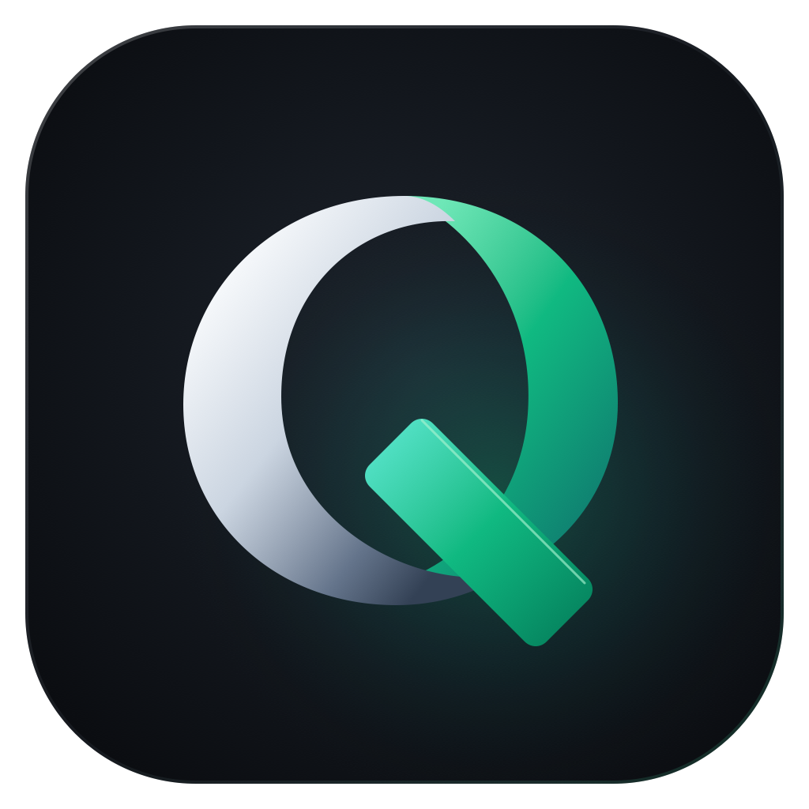
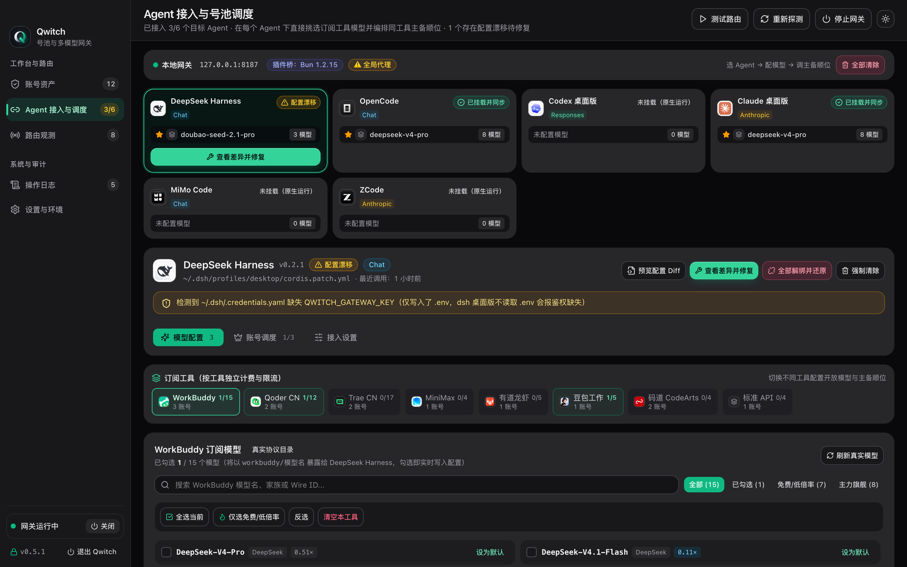
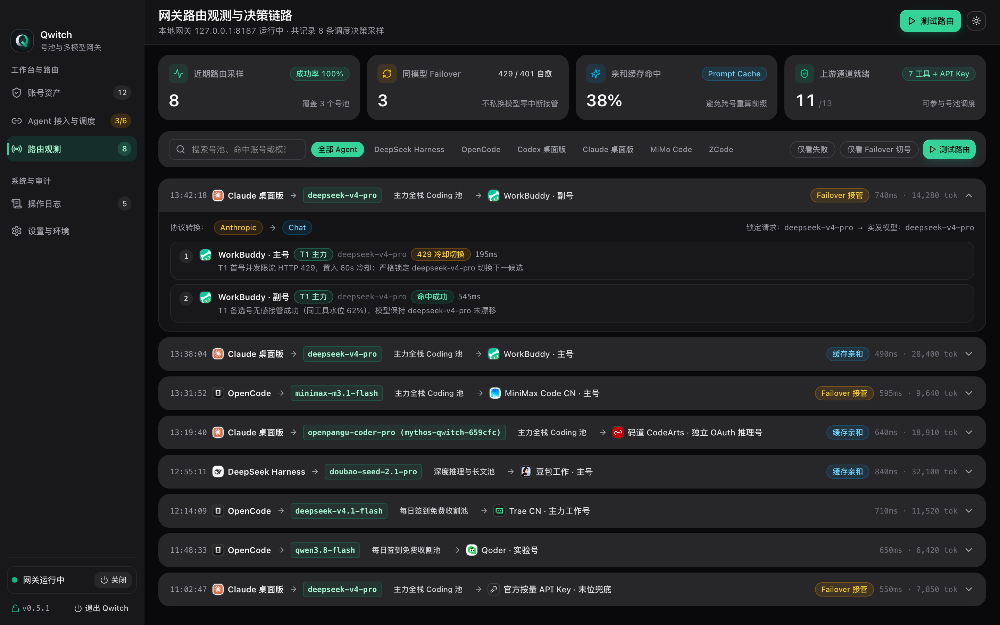
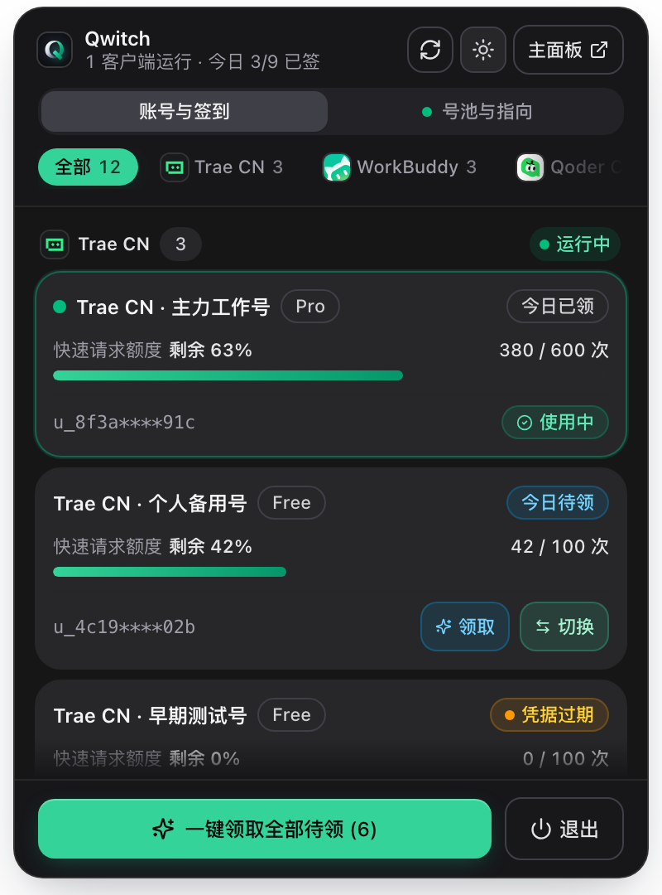
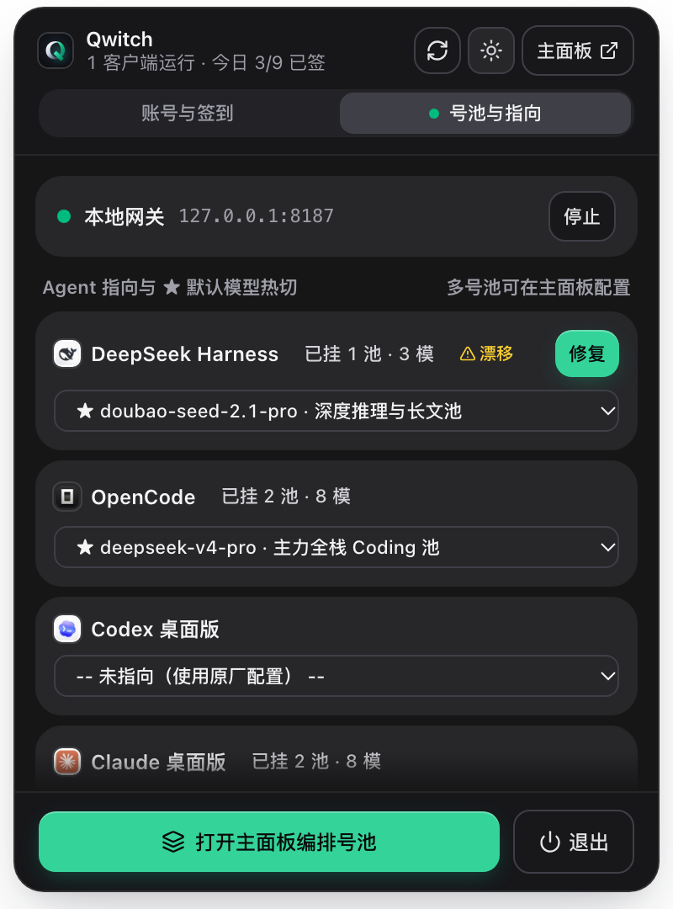

<div align="center">



# Qwitch

**本地优先的 AI 工具多账号管理、同工具号池调度与本地多协议网关桌面应用**

*Quota + Switch + Pool Gateway —— 额度水位一目了然，每日福利一键领取，多账号无缝切换，并可将订阅模型通过本地网关统一接入主流 AI Agent。*

[](https://github.com/LuckyOneTwoThree/Qwitch/actions/workflows/ci.yml)
[](https://github.com/LuckyOneTwoThree/Qwitch/actions/workflows/release.yml)
[](https://github.com/LuckyOneTwoThree/Qwitch/releases)
[](LICENSE)
[](#快速开始)
[](https://v2.tauri.app/)

[下载安装](#快速开始) · [功能特性](#功能特性) · [支持的工具与 Agent](#支持的工具) · [安全与隐私](#安全与隐私) · [架构设计](#架构设计) · [开发指南](#开发指南) · [文档索引](#文档索引) · [问题反馈](https://github.com/LuckyOneTwoThree/Qwitch/issues)

</div>

---

## 简介

**Qwitch** 帮助开发者在本机有序管理多个 AI 开发与办公工具账号：集中查看各账号额度水位与签到状态，手动一键领取每日积分 / Credits，将选定账号的登录态安全切换到本地桌面客户端；同时内置**本地多协议网关（默认 `127.0.0.1:8187`）与号池调度引擎**，可将 7 大已纳管 AI 工具的订阅模型按同工具主备顺位统一暴露给 **Codex 桌面版、Claude 桌面版、DeepSeek Harness、OpenCode、MiMo Code、ZCode** 及任意兼容 OpenAI / Anthropic 的客户端。

所有数据 **100% 存储于本机**——零云端服务器、零遥测上报。基于 [Tauri v2](https://v2.tauri.app/)（Rust + TypeScript）构建，安装包轻量、内存占用低，代码完全开源可审计。

> **产品边界**：Qwitch 坚持 Human-in-the-Loop——查询、领取、切号、启动本地网关与挂载 Agent 均由用户主动触发；本地网关、后台自动刷新与自动签到均**默认关闭**，开启需显式操作（自动签到需二次确认）。不内置高频轮询、不做无人值守挂机，最大程度规避平台风控。

## 产品截图

> 截图来自浏览器 Mock 预览模式（v0.5.1），账号、额度、路由记录与 Agent 配置均为示例数据。

| 主窗口 · 账号资产（浅色） | 主窗口 · 账号资产（深色） |
| :---: | :---: |
|  |  |

| Agent 接入与号池调度（深色） | 网关路由观测与决策链路（深色） |
| :---: | :---: |
|  |  |

| 系统托盘 · 账号与签到（浅色） | 系统托盘 · 账号与签到（深色） |
| :---: | :---: |
|  |  |

<details>
<summary><b>系统托盘 · 号池与指向（深色）</b>：网关启停、Agent 默认模型热切、漂移修复与号池聚合水位</summary>



</details>

<details>
<summary><b>设置与环境（深色）</b>：常驻偏好、自动化策略、日志保留、本地网关端口与占用检测、客户端环境探测与路径覆盖</summary>


</details>

## 功能特性

### 🌐 本地多协议网关与号池调度

- **多协议统一 IR 互转**：内置轻量 Rust 本地网关（默认监听 `127.0.0.1:8187`，端口支持自定义、占用检测与持久化），原生支持 **OpenAI Chat Completions**、**Anthropic Messages**（含 `/v1/messages/count_tokens`）与 **OpenAI Responses**（含 `/v1/responses/compact`，WebSocket 升级自动返回 426 平滑降级 HTTP SSE）。
- **真流式透传与完整工具调用**：同协议（OpenAI Chat / Anthropic Messages）零拷贝 SSE 透传，跨协议支持文本实时增量流式与 UTF-8 安全解码；完整透传 `tools` / `tool_choice` 与 `tool_use` / `tool_calls` 双向映射，并统一归一化跨协议结束原因与 token 用量（OpenAI Responses 跨协议增量流式支持通过环境变量 `QWITCH_GATEWAY_RESPONSES_STREAMING=1` 按需开启）。
- **严格锁模 · 同工具主备调度**：请求严格锁定用户选择的模型，绝不私自偷换模型；支持「主号优先 · 自动切备（order）」「剩余额度优先（quota_first）」「锁定消耗当前主号（drain）」「进程内原子轮询（round_robin）」以及 Prompt Cache 会话亲和。
- **高可用与防互踢护栏**：支持跳过本机桌面端活跃账号、429 限流自动冷却并首字节前无缝 Failover、401 按 `account_id` 单飞刷新 Token 回写加密库，并支持配置通用 API Key 作为 T3 末位兜底。

### 🔗 目标 Agent 一键接入与安全还原

- **6 大目标 Agent + 通用标准端点**：直接在「Agent 接入与号池调度」3 分区工作台（模型配置 / 账号调度 / 接入设置）内按订阅工具勾选开放模型、设置 `★ 默认模型`、编排同工具主备顺位并一键同步至全部 Agent。
- **实时模型探测与智能筛选**：支持一键拉取上游真实模型目录，提供搜索与「全部 / 已勾选 / 免费低倍率 / 主力旗舰」快捷筛选及批量勾选工具栏；接入卡实时显示模型数、挂载号池与 `配置漂移 / 已挂载 / 未挂载` 状态。
- **Stash 加密备份与无损还原**：修改目标 Agent 配置文件前自动将原文件 AES-256-GCM 加密存入 Stash，操作前通过 `ConfigDiffModal` 透明预览 Before/After 差异；配置解析失败时直接中止写入，绝不以空文档覆盖用户原有配置；支持配置漂移检测与一键修复、无损解绑还原、按 Agent 或全部强制清除 Qwitch 写入。
- **桌面客户端平滑重启与重新探测**：内置优雅退出 → 轮询确认退出 → 重启机制（含 Claude 独立双开副本与 DSH），修改网关端口后可一键批量重启运行中的桌面 Agent；未安装客户端自动禁用重启入口，并支持重新探测本机 Agent 环境。

### 📡 路由观测与连通性演练

- **实时决策链路观测**：展示近期路由采样数、成功率、同模型 Failover 次数、Prompt Cache 亲和命中率与上游通道就绪度；支持按来源 Agent、关键词、「仅看失败（带计数）」「仅看 Failover 切号」筛选。
- **Attempt Timeline 与故障注入测试**：点击任意采样记录展开完整协议转换与逐跳尝试明细；内置「网关路由连通性测试」弹窗，支持正常直连、注入首号 429 限流与注入 401 刷新演练，以及同会话连续发包验证冷却跳过与亲和命中。

### 🖥️ 双态交互

- **系统托盘 / 菜单栏双态弹层**：支持「账号与签到」与「号池与指向」双页签切换——既可一键查额、领取与冷切桌面账号，也可直接启停本地网关、热切各 Agent 的 `★ 默认模型`、处理漂移/待重启并查看号池聚合水位。
- **主窗口 Dashboard**：侧栏收拢为 5 大核心功能域（账号资产、Agent 接入与调度、路由观测、操作日志、设置与环境），支持顶部标题区全宽拖拽与双击最大化；浅色 / 深色 / 跟随系统三态主题，首帧无白闪。
- **两种账号视图**：分组视图按工具聚合；平铺视图按「待处理 → 可领取 → 挂载中 → 其余」分层排序，层内工具顺序与分组视图一致，切换视图时卡片不跳位。
- **托盘常驻**：关闭主窗口默认收起至托盘；可选隐藏 Dock 图标、开机自启、启动最小化。

### 📊 额度与签到

- 多账号额度水位与套餐周期监控，签到状态区分「可领 / 已领 / 待核实 / 不支持」，统计口径前后端统一、互斥闭合。
- 一键批量领取 / 批量查额，实时进度条与部分失败汇总；「核实并领取」对状态未知账号先查后领。
- 操作日志全量留痕，支持归档 / 恢复 / 筛选 / 分页 / 导出，保留策略可配置。

### 🔀 账号冷切换与防风控调度

- **一键冷切换**：优雅关闭客户端 → 备份原会话 → 写入目标账号登录态 → 拉起客户端并确认存活，全程事务化；并发互斥、失败自动回滚原会话；自定义客户端安装路径全链路生效。
- **防风控调度**：单队列严格串行 + 随机抖动延迟（Jitter，默认 1500–3500ms，下限 500ms）；幂等前置校验、业务级 401/403/429 统一映射、**工具级熔断**、批量重入直接拒绝（与网关推理通道彻底锁隔离，互不阻塞）。

### 🔄 软件更新与可扩展性

- **软件更新**：启动后静默检查 GitHub Releases；Windows 下载官方 NSIS 安装包并校验 SHA256 后自动拉起升级，macOS 按架构下载 DMG 并提供 Gatekeeper 放行指引。
- **外部插件扩展**：核心为 Rust `ToolAdapter` trait；外部适配器遵循标准 **JSON-RPC 2.0** 协议，需经系统原生确认对话框签发一次性哈希绑定票据后启用（重启生效）。

### ✅ 工程质量

- **206 个 Rust 单元 / 回归测试 + 130 个前端 Vitest 测试**；GitHub Actions **macOS + Windows 双平台**门禁：依赖审计、ESLint（`--max-warnings=0`）、构建、测试、`cargo fmt` / `clippy -D warnings` / `cargo audit`。
- 标签触发 Release 流水线，自动构建并发布 macOS Apple Silicon（arm64）、macOS Intel（x64）与 Windows x64 三个独立安装包。

## 支持的工具

### 上游 AI 工具适配器（7 个内置 + 通用 API Key）

| 工具 | 登录态获取 | 额度 / 每日领取 | 本地客户端切换 | 号池网关调度 |
| --- | --- | --- | --- | --- |
| **Trae CN** | 内置 WebView 登录 · 本机导入 · Token | 额度与套餐水位、每日签到 Credits | ✅ 一键冷切换 | ✅ 支持入池 |
| **WorkBuddy** | 本机凭据导入 · 内置授权 · Token | 签到状态监控、一键签到与积分领取 | ✅ 一键冷切换 | ✅ 支持入池（含通道兼容清洗） |
| **Qoder CN** | 本机导入 · 内置 PKCE 授权 · PAT | 活动 Credits 水位、一键领取 | ✅ 一键冷切换 | ✅ 支持入池 |
| **MiniMax Code CN** | 本机导入 · 内置设备码授权 · Token | 积分水位、每日签到领取 | ✅ 一键冷切换 | ✅ 支持入池（Anthropic 原生） |
| **LobsterAI（有道龙虾）** | 内置 OAuth 授权 · 本机导入 · Token | 积分水位监控、每日签到领取 | ✅ 一键冷切换 | ✅ 支持入池 |
| **豆包工作（DoubaoWork）** | 内置 WebView Cookie 授权 · 本机导入 · Cookie/cURL | 多维度额度与额度包监控、每日签到 | ✅ 一键冷切换 | ✅ 支持入池 |
| **码道 CodeArts** | 本机导入（safeStorage）· Token | 积分水位监控（华为云 AK/SK 签名） | — 仅监控 | ⚠️ 需独立 OAuth 隔离授权后入池 |
| **通用 API Key** | API Key + Base URL | — | — | ✅ 锁定 T3 兜底档 |

> Trae / Qoder 国际版无每日签到机制，暂未注册内置适配器；外部适配器协议可用于自行扩展。
>
> 码道 CodeArts 客户端 `refreshToken` 为一次性轮换机制，客户端导入账号默认标记为只读监控，防止与官方 IDE 登录态互废；需在号池中完成独立 OAuth 授权后方可参与推理调度。

### 支持接入的消费端 Agent（6 大客户端 + 通用端点）

| 目标 Agent | 入口协议 | 目标配置文件 | 专属适配与护栏 |
| --- | --- | --- | --- |
| **Codex 桌面版** | OpenAI Responses | `~/.codex/config.toml` + `qwitch_models.json` | 独立 `[model_providers.qwitch]` 表（解绑保留防旧线程报错）、未匹配模型自动直通 Codex 自有登录态、系统全局代理 502 预警与 `NO_PROXY` 复制 |
| **Claude 桌面版** | Anthropic Messages | `Claude/claude_desktop_config.json` + `Claude-3p/` | `3p` 网关模式、非 Anthropic 模型自动伪装 `mythos-qwitch-*` 过白名单、macOS 独立双开隔离副本、优雅退出轮询重启 |
| **DeepSeek Harness (DSH)** | OpenAI Chat | `~/.dsh/profiles/*/cordis.patch.yml` + `.env` + `.credentials.yaml` | 仅修改 `llm-pi-ai` 不覆盖原生行、双写 `.env` 与 `.credentials.yaml` 并自动检测漂移 |
| **OpenCode** | OpenAI Chat | `opencode.jsonc` / `opencode.json` | 支持 `v1 (provider)` / `v2 (providers)` Schema 切换，解析失败中止保护原配置 |
| **MiMo Code** | OpenAI Chat | `~/.mimocode/settings.json` | 标准 OpenAI Chat 兼容接入，支持桌面端状态探测与一键重启 |
| **ZCode** | Anthropic Messages | `~/.zcode/settings.json` | 标准 Anthropic Messages 兼容接入，支持桌面端状态探测与一键重启 |
| **通用标准端点** | OpenAI / Anthropic | 环境变量导出 | 一键复制 `OPENAI_BASE_URL` / `ANTHROPIC_BASE_URL` 供任意第三方客户端使用 |

## 快速开始

### 下载安装

前往 [**Releases**](https://github.com/LuckyOneTwoThree/Qwitch/releases) 下载对应平台安装包：

| 平台 | 架构 | 产物 |
| --- | --- | --- |
| macOS 11+ | Apple Silicon | `Qwitch_*_aarch64.dmg` |
| macOS 10.15+ | Intel | `Qwitch_*_x64.dmg` |
| Windows 10+ | x64 | `Qwitch_*_x64-setup.exe` / `.msi` |

> **macOS 签名提示**：当前版本为 ad-hoc 签名（无 Apple Developer 证书、未公证）。首次打开被 Gatekeeper 拦截时，请按提示类型处理：「无法验证开发者」→ 系统设置中选「仍要打开」；「已损坏」→ 执行 `xattr -dr com.apple.quarantine /Applications/Qwitch.app`。详见 [FAQ](#faq)。Windows SmartScreen 提示时选择「更多信息 → 仍要运行」。

### 从源码构建

**前置条件**：Node.js ≥ 22 · Rust stable（≥ 1.88，含 `clippy` / `rustfmt`）· macOS 或 Windows 桌面环境（Tauri v2 依赖系统 WebView）。

```bash
git clone https://github.com/LuckyOneTwoThree/Qwitch.git
cd Qwitch
npm install
npm run tauri dev      # 开发模式运行桌面应用
npm run tauri build    # 构建本地安装包
```

### 上手流程

1. **导入账号**：主窗口「账号资产 → 导入账号」→ 选择工具 → 本机导入 / 内置授权 / 粘贴 Token；
2. **查看额度与领取**：卡片自动展示额度水位与签到状态，可单卡刷新或一键批量领取（串行 + 抖动）；
3. **切换桌面账号**：卡片「切换」→ 确认冷切换，客户端自动重启至目标账号；
4. **接入 Agent 与号池调度**：进入「Agent 接入与调度」→ 启动本地网关（默认 `127.0.0.1:8187`）→ 选择目标 Agent 并勾选订阅工具模型、编排主备顺位 → 重启对应桌面客户端即可使用；端口可在「设置与环境 → 客户端环境」修改，并一键批量重启已挂载的桌面 Agent；
5. **路由观测与托盘速览**：在「路由观测」按来源 Agent、关键词或「仅看失败 / 仅看 Failover」筛选每次请求的协议转换与逐跳尝试明细，或通过菜单栏托盘随时切换账号、启停网关与热切默认模型。

## 配置项

| 设置 | 默认值 | 说明 |
| --- | --- | --- |
| 主题 | 跟随系统 | 浅色 / 深色 / 系统，运行时跟随系统切换 |
| 关闭主窗口 | 收起至托盘 | 可选直接退出 |
| 隐藏 Dock 图标（macOS） | 关 | 纯菜单栏模式 |
| 开机自启 / 启动最小化 | 关 | 按需开启 |
| 本地网关监听端口 | **8187** | 仅监听 `127.0.0.1`（范围 `1024–65535`），支持占用检测、持久化、自动同步已挂载 Agent 并批量重启运行中桌面 Agent |
| 启动时自动刷新 | **关** | 显式开启后仅启动时巡检一次 |
| 后台定时刷新间隔 | **0（关闭）** | 开启后仅主窗口可见时执行 |
| 自动后台签到 | **关** | 开启需二次确认（无人值守敏感动作） |
| 抖动间隔 | 1500–3500ms | 后端强制下限 500ms |
| 日志归档 / 活跃上限 | 14 天 / 200 条 | 超期自动归档，可恢复 / 导出 |
| 自定义客户端路径 | 自动探测 | 按工具覆盖，全链路生效 |
| 外部插件信任 | 全部未信任 | 需经系统原生对话框确认（签发一次性票据），重启生效 |

## 安全与隐私

- **本地优先**：凭据、会话快照、额度记录、号池配置、Agent 原文件 Stash 与操作日志全部存于本机数据目录，无任何云端上传与遥测。
- **密钥托管**：主密钥优先存入系统原生钥匙串（macOS Keychain / Windows Credential Manager），并在数据目录同步维护受权限保护（Unix `0600`）的 `master.key` 备份以兼容跨证书/重装升级场景；启动时以 `key_id` 指纹 + 密文样本**双重验证**候选密钥，冲突来源绝不误删，验证通过前不做任何清理。
- **加密落盘**：业务凭据与 Agent 原始配置 Stash 均采用 AES-256-GCM 加密（随机 nonce + `QWA1` 账号 AAD 绑定），明文缓冲区用后即清零（zeroize）；SQLite 启用 WAL，数据库 / 导出文件 `0600`、数据目录 `0700`。
- **本地网关安全边界**：网关默认关闭，仅绑定 `127.0.0.1:<port>`；强校验 `Host` 头并拦截携带 `Origin` 或 `Sec-Fetch-Site: cross-site` 的浏览器请求（403，防 DNS Rebinding 与 CSRF）；全路由强制校验每装机随机绑定令牌（无/错令牌返回 401）；校验上游 `base_url` 白名单（防 SSRF），对请求头、请求体（16 MB）与非流式上游响应（64 MB）施加体积上限与连接读超时；跨池路由严格按目标 Agent 挂载范围隔离。
- **配置无损保护**：写入目标 Agent 配置文件前先加密 Stash 备份，多文件写入失败按 Stash 回滚；若原有 JSON/JSONC/TOML 解析失败则直接中止写入并报错，绝不以空文档覆盖用户配置。
- **PII 脱敏**：默认账号标签、审计日志与路由观测链路自动脱敏邮箱 / 手机号 / UID / Cookie 会话凭据，不存储 Prompt 或模型回复明文。
- **严格 CSP**：`script-src 'self'`，禁用内联脚本与外部加载，`object-src 'none'` / `base-uri 'self'` / `frame-ancestors 'none'`。
- **授权隔离**：内置 OAuth 窗口校验一次性 nonce + 精确回调路径 + 流程序号，导航限定官方域名白名单；nonce **一次性消费**，同一回调重复投递会被拒绝。
- **插件零信任**：外部适配器默认不加载、不接收凭据；信任需经**系统原生确认对话框**签发与内容哈希绑定的一次性票据（120 秒有效、用后即焚），启动与每次 RPC 执行前均重校验目录内容哈希与入口命令/参数约束（仅放行插件目录内脚本与白名单解释器）。
- **IPC 最小权限**：**73 个**应用命令经 `build.rs` 声明并按 `main` / `tray` 窗口拆分 capability（`tray` 仅开放只读、刷新、领取、切号与网关/热切所需最小命令集），渲染进程无法调用未授权能力。
- **可执行文件白名单**：自定义客户端路径在保存与启动两个环节校验名称、bundle 结构与受信任安装目录，避免「写入任意路径 → 启动执行」链路。
- **更新防降级**：安装前重新拉取最新版本，校验版本单调性与资产 / 校验和地址逐字一致，阻断降级安装与跨版本替换。
- **失败熔断**：401 → 凭据过期、403/429 → 风控暂停并熔断该工具；5xx / 网络错误连续 3 次同样熔断，避免平台整体不可用时逐个账号硬打。

**数据目录**

| 平台 | 路径 |
| --- | --- |
| macOS | `~/Library/Application Support/qwitch` |
| Windows | `%APPDATA%\qwitch` |

> 从旧版 Quiver 升级时，数据目录与钥匙串密钥会自动迁移。

## 架构设计

```
┌──────────────────────────── Qwitch Desktop ────────────────────────────┐
│  React 18 + TypeScript + Tailwind CSS 4 (Vite 6)                       │
│  Dashboard 主窗口（账号/Agent接入/路由观测/日志/设置）· Tray 双态弹层  │
│  Context 状态中枢（Account/Log/Settings/Feedback/Pool）· Selectors     │
└──────────────────────────────▲─────────────────────────────────────────┘
                               │ Tauri IPC（73 个 ACL 命令 / events）
┌──────────────────────────────▼─────────────────────────────────────────┐
│  Rust Core                                                             │
│  ├─ commands ── scheduler（串行 + Jitter + 幂等 + 工具级熔断）         │
│  ├─ gateway（127.0.0.1:8187 多协议 IR 互转 + 真流式 + 号池调度/冷却）  │
│  ├─ agent_wiring（6 大 Agent 探测 / Stash 备份 / Diff / 漂移 / 重启）  │
│  ├─ ToolAdapter trait                                                  │
│  │    ├─ trae_cn / workbuddy / qoder_cn / minimax_code_cn              │
│  │    ├─ lobsterai / doubaowork / codearts（共 7 个内置适配器）        │
│  │    └─ external：JSON-RPC 2.0 插件（原生确认 + 运行时哈希校验）      │
│  ├─ platform（钥匙串 / 进程探测 / 路径解析 / 开机自启）                │
│  └─ storage（SQLite WAL + AES-256-GCM + 号池/路由/模型发现 + 迁移）    │
└────────────────────────────────────────────────────────────────────────┘
```

| 层 | 技术 |
| --- | --- |
| 桌面框架 | Tauri v2（tray-icon、macOS private API、single-instance） |
| 前端 | React 18 · TypeScript（strict）· Tailwind CSS 4 · Vite 6 · Vitest |
| 后端 | Rust（≥ 1.88）· tokio · rusqlite（bundled SQLite）· reqwest（rustls）· keyring v3（原生后端）· aes-gcm |
| 质量 | cargo fmt / clippy `-D warnings` / test · cargo audit · tsc · ESLint · Vitest · wiremock · npm audit |

<details>
<summary><b>目录结构</b></summary>

```
Qwitch/
├─ src/                      # 前端
│  ├─ pages/                 # Dashboard 主窗口 / TrayPopover 双态托盘
│  │  └─ dashboard/          # AgentBindingsView / RoutingTraceView / LogsView / SettingsView
│  ├─ components/            # 账号卡片、导入/切号弹窗、gateway/ 端口弹窗、pool/ 演练与 Diff 弹窗
│  ├─ context/               # 状态中枢（账号/日志/设置/反馈/号池网关）
│  ├─ domain/                # selectors 统计口径 / toolRegistry
│  └─ data/                  # 开发态浏览器预览 Mock（生产构建自动剔除）
├─ src-tauri/                # Rust 后端
│  └─ src/
│     ├─ commands/           # Tauri IPC 命令（accounts/pools/profile/settings/switch/logs/oauth）
│     ├─ gateway/            # 本地多协议网关（HTTP/1.1 + SSE、IR 转换、号池调度器）
│     ├─ agent_wiring/       # 6 大目标 Agent 探测、配置写入、Stash 还原、漂移检测与重启
│     ├─ adapter/            # 7 个内置适配器 + JSON-RPC 外部协议
│     ├─ scheduler/          # 防风控串行调度器
│     ├─ platform/           # 钥匙串 / 进程 / 路径 / 自启
│     ├─ storage/            # SQLite + 加密 + 号池持久化 + 上游模型发现 + 迁移
│     └─ domain/             # 领域模型、号池模型与设置
├─ docs/                     # 架构 / 契约 / 适配器规范 / 号池网关设计 / 审计文档
└─ .github/workflows/        # CI 双平台门禁 + Release 流水线
```

</details>

## 开发指南

```bash
npm install                  # 安装前端依赖
npm run dev                  # 仅前端（浏览器 Mock 预览）
npm run tauri dev            # 桌面应用开发模式
npm run build                # 前端类型检查 + 生产构建
npm run lint                 # ESLint（--max-warnings=0）
npm test                     # 前端测试（Vitest，23 文件 / 130 例）
cd src-tauri && cargo test   # 后端测试（206 例）
cargo fmt --check && cargo clippy --all-targets -- -D warnings
```

**CI/CD**

- `ci.yml`：push / PR 触发，macOS + Windows 双平台执行生产依赖审计、ESLint、前端构建与测试、Tauri `--no-bundle` 构建冒烟、`shellcheck`（Linux）、Rust `cargo audit` / fmt / clippy / test。
- `release.yml`：`v*` 标签触发，先跑验证门禁，再构建 macOS ARM64、macOS Intel 与 Windows x64 三个独立安装包并上传至 GitHub Release（自动发布 latest）。

**发布前手工清单**：空数据目录首装 · 备份恢复到冲突钥匙串环境 · 慢启动客户端切号 · 托盘 / Dock 行为 · 本地网关端到端路由与目标 Agent 重启生效。

> `npm audit`（含 devDependencies）实测 **0 漏洞**。

## 文档索引

| 文档 | 内容 |
| --- | --- |
| [架构与基线设计](docs/ARCHITECTURE.md) | 项目定位、核心架构、防风控规范、非目标与路线图 |
| [核心契约与数据模型](docs/CORE_DESIGN.md) | 领域模型、Rust Trait、JSON-RPC 协议、SQLite Schema、IPC 契约 |
| [内置适配器规范](docs/ADAPTER_SPEC.md) | 各工具本地存储路径、加密格式、服务端接口与幂等契约 |
| [号池网关架构设计](docs/POOL_GATEWAY_DESIGN.md) | 号池优先→指向 Agent 总体架构、IR 转换、7 上游凭据接入与 6 Agent 挂载规范 |
| [号池产品形态与 UX 规范](docs/POOL_GATEWAY_PRD_UX.md) | 产品心智链路、信息架构、Agent 接入与调度 / 路由观测及双态托盘交互规范 |
| [2026-11-24 项目状态深度审查](docs/PROJECT_STATE_REVIEW_2026-11-24.md) | 号池与网关大版本全量审计、安全/稳定性评估与修复进度追踪 |
| [品牌与命名规范](docs/BRAND_IDENTITY.md) | Qwitch 品牌定位、命名与视觉原则 |
| [前端体验审计](docs/FRONTEND_UX_AUDIT.md) | 历史基线问题表与修复状态标注 |
| [后端安全审计](docs/BACKEND_ARCH_REVIEW.md) | 历史基线问题表与修复状态标注 |
| [全方位深度审查](docs/PROJECT_AUDIT_REPORT.md) | 2026-11-20 全项目功能、安全、性能与工程质量审查 |
| [项目认知总结](docs/PROJECT_COGNITION_SUMMARY.md) | 二次开发基线：模块职责、关键流程与易错点 |
| [UI 视觉质感优化报告](docs/UI_VISUAL_REFINEMENT.md) | 视觉层级、密度、动效与控件质感的设计与实现基线 |
| [综合优化路线图](docs/OPTIMIZATION_ROADMAP.md) | 四阶段 Sprint 排期、完成度与接口变更总表 |
| [项目理解报告](docs/PROJECT_UNDERSTANDING_REPORT.md) | 全项目深度认知基线：目标、模块、流程、实测质量基线、问题分级与待确认事项 |
| [优化执行计划](docs/OPTIMIZATION_EXECUTION_PLAN.md) | A/B/C/D 四阶段落地记录：实现要点、回归测试与延后项依据 |

## 路线图

- [x] `uid_hash` 升级 HMAC-SHA256、AES-GCM 绑定账号 AAD（含旧库平滑迁移）
- [x] 外部插件内容哈希 / 签名固定，内容变更重新确认
- [x] OAuth 凭据改受限本地传递（本地 sentinel + fragment + nonce/flow 校验，拒绝从 URL query 读取）
- [x] 旧版数据迁移改用 SQLite backup API、归档日志自动清底（5000 上限）
- [x] Context 按更新频次拆分（Account/Log/Settings/Feedback/Pool）+ 单账号增量同步
- [x] 组件级测试与 Tauri bundle CI 构建校验、ESLint 接入 CI、wiremock HTTP 测试基建
- [x] IPC 命令级 ACL（73 命令按 `main` / `tray` 窗口最小授权）、插件信任原生确认票据（哈希绑定）、客户端可执行文件白名单
- [x] 更新防降级（版本单调性 + 资产一致性校验）、OAuth nonce 一次性消费、5xx 连续熔断
- [x] WAL 增长治理、日志统计覆盖索引与命令异步化、mock 数据生产构建自动剔除
- [x] 本地多协议网关（默认 `127.0.0.1:8187`，端口可配/检测/持久化）+ 统一 IR 互转 + `tools`/`tool_choice` 完整透传
- [x] 同协议零拷贝 SSE 透传 + 跨协议文本实时增量流式（含 UTF-8 安全解码与 tool_use/tool_calls 映射）
- [x] 6 大目标 Agent 一键挂载（Codex / Claude / DSH / OpenCode / MiMo Code / ZCode）+ Stash 加密备份/无损还原 + 漂移检测 + 桌面端优雅重启
- [x] 网关随机绑定令牌全路由鉴权、请求/响应体积上限、上游 `base_url` 白名单与 600s 长超时专用连接
- [x] 号池写库事务化、Agent 配置解析失败中止、多文件写入 Stash 回滚、Mock 生产门禁与并发乱序保护
- [x] 网关端口 `8187` 持久化 + 占用检测 + 已挂载 Agent 自动重写 + 运行中桌面客户端批量重启
- [x] 路由观测面板（来源 / 关键词 / 仅看失败 / 仅看 Failover 筛选与空态）、连通性演练弹窗（429/401 故障注入）与双态托盘热切体验
- [ ] 代码签名 / 公证与自动更新（release.yml 已接入可选 Apple 签名 secrets；**需提供 Apple Developer 证书/凭证**方可真正签名公证；Windows 自动安装已具备）
- [ ] OpenAI Responses 跨协议增量流式默认启用（当前已实现并通过集成测试，可通过 `QWITCH_GATEWAY_RESPONSES_STREAMING=1` 启用，待真机 Codex 长对话回归后转正）
- [ ] Context 订阅粒度拆分、`julianday` 索引重建、日志列表虚拟化（当前规模下无感，按需启动）

## 贡献

欢迎 Issue 与 PR：

1. Fork 本仓库并创建特性分支（`feat/xxx` / `fix/xxx`）；
2. 提交信息遵循 `feat:` / `fix:` / `chore:` 约定，说明动机与影响；
3. 为修复 / 新功能补充回归测试，确保 `npm test`、`cargo test`、`clippy -D warnings` 全绿；
4. 提交 PR 并描述变更与验证方式，CI 双平台通过后合并。

## FAQ

<details>
<summary><b>macOS 提示「已损坏」或「无法验证开发者」？</b></summary>

当前版本使用 **ad-hoc 签名**（无 Apple Developer 证书、未公证），因此 Gatekeeper 会拦截。两种提示的成因与解法不同，请对号入座。

**先做这一步**：把 `Qwitch.app` 拖进 `/Applications`（不要留在 `~/Downloads` 或挂载的 DMG 里操作）。

**情况 A：提示「无法验证开发者，无法打开」**

这是签名有效但无证书信任，系统已提供放行入口：

1. 打开「系统设置 → 隐私与安全性」
2. 滚动到底部，在「安全性」区域点击 **「仍要打开」**
3. 再次双击应用，弹窗中确认「打开」

**情况 B：提示「已损坏，应移到废纸篓」**

这是下载隔离属性（quarantine）导致的校验失败，系统**不会**提供「仍要打开」按钮，需手动清除隔离属性：

```bash
xattr -dr com.apple.quarantine /Applications/Qwitch.app
```

执行后重新双击即可打开。

> 说明：`-dr com.apple.quarantine` 只删除隔离属性（`-d` 删除指定属性，`-r` 递归）。若上述命令无效，可改用 `xattr -cr /Applications/Qwitch.app` 清除全部扩展属性。
</details>

<details>
<summary><b>启动时提示密钥不匹配 / 拒绝启动？</b></summary>

这是保护机制：检测到已有加密数据但候选密钥无法通过指纹 + 样本双重验证（常见于部分备份恢复、钥匙串条目丢失）。请恢复正确的系统钥匙串条目或 `master.key` 备份；**数据目录中的密钥文件与数据库均会被保留**，切勿直接删除数据目录。
</details>

<details>
<summary><b>修改本地网关端口后，已打开的桌面 Agent 怎么生效？</b></summary>

修改端口时 Qwitch 会自动检测端口占用、重启本地网关并重新同步所有已挂载 Agent 的配置文件，同时将新端口持久化到应用设置。对于 **Claude 桌面版、Codex 桌面版、MiMo Code、ZCode** 等启动时读取配置的桌面客户端，可在「设置与环境 → 客户端环境」修改端口后直接确认一键批量重启，或在「Agent 接入与调度」页点击单个客户端的「重启」按钮。
</details>

<details>
<summary><b>会触发平台风控吗？</b></summary>

Qwitch 默认全手动触发，批量操作严格串行 + 随机抖动 + 幂等跳过 + 工具级熔断，本地网关、自动刷新与自动签到均默认关闭；号池调度亦默认开启「跳过桌面端活跃账号」与 429 自动冷却避让。但任何自动化或代理辅助都存在平台策略风险，请遵守目标平台用户协议，风险自负。
</details>

## 许可证

[MIT](LICENSE) © Qwitch Contributors

## 免责声明

本项目仅用于辅助个人管理**本人合法持有**的多账号本地会话与额度信息，严禁用于批量注册、自动化薅羊毛、绕过计费或任何违反目标平台用户协议的行为。使用本工具所产生的账号异常或合规风险由使用者自行承担。

---

<div align="center">

**Qwitch** —— 把多账号的混乱，收进一个托盘；把多模型的调度，收进本地网关。

Built with [Tauri](https://v2.tauri.app/) · [React](https://react.dev/) · [Rust](https://www.rust-lang.org/)

</div>
