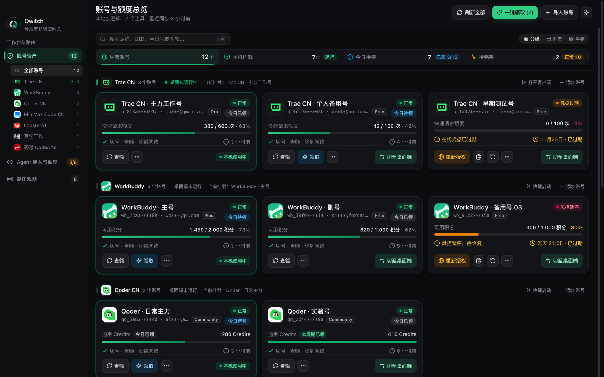
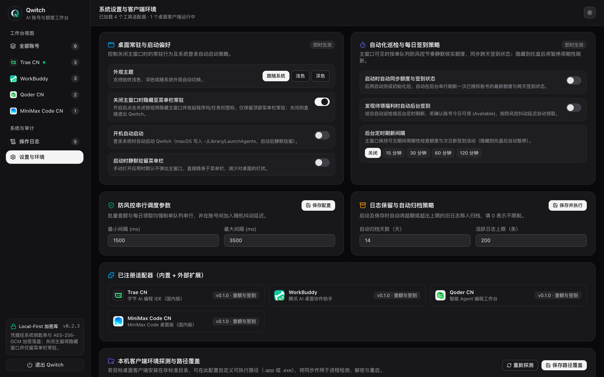

<div align="center">


# Qwitch

**本地优先的 AI 工具多账号会话与每日额度管理桌面应用**

*Quota + Switch —— 额度水位一目了然，每日福利一键领取，账号切换干净利落。*

[](https://github.com/LuckyOneTwoThree/Qwitch/actions/workflows/ci.yml)
[](https://github.com/LuckyOneTwoThree/Qwitch/actions/workflows/release.yml)
[](https://github.com/LuckyOneTwoThree/Qwitch/releases)
[](LICENSE)
[](#快速开始)
[](https://v2.tauri.app/)

[下载安装](#快速开始) · [功能特性](#功能特性) · [安全与隐私](#安全与隐私) · [架构设计](#架构设计) · [开发指南](#开发指南) · [文档索引](#文档索引) · [问题反馈](https://github.com/LuckyOneTwoThree/Qwitch/issues)

</div>

---

## 简介

**Qwitch** 帮助开发者在本机有序管理多个 AI 开发与办公工具账号：集中查看各账号额度水位与签到状态，手动一键领取每日积分 / Credits，并将选定账号的登录态安全切换到本地桌面客户端。

所有数据 **100% 存储于本机**——零云端服务器、零遥测上报。基于 [Tauri v2](https://v2.tauri.app/)（Rust + TypeScript）构建，安装包轻量、内存占用低，代码完全开源可审计。

> **产品边界**：Qwitch 坚持 Human-in-the-Loop——查询、领取、切号均由用户主动触发；后台自动刷新与自动签到**默认关闭**，开启需显式确认。不内置高频轮询、不做无人值守挂机，最大程度规避平台风控。

## 产品截图

> 截图来自浏览器 Mock 预览模式，账号与额度均为示例数据。
>
> **注意**：截图拍摄于视觉体系重构（设计令牌 / 配色 / 字号阶梯）之前，界面细节与当前版本存在差异，功能布局与信息层级仍具参考价值。

| 主窗口 · 浅色 | 主窗口 · 深色 |
| :---: | :---: |
|  |  |

| 系统托盘 · 浅色 | 系统托盘 · 深色 |
| :---: | :---: |
|  |  |

<details>
<summary><b>设置与环境（深色）</b>：常驻偏好、自动化策略、防风控调度、日志保留、适配器与客户端路径</summary>



</details>

## 功能特性

### 🖥️ 双态交互

- **系统托盘 / 菜单栏弹层**：高频轻量入口，随时查看各工具活跃账号与剩余额度，一键切号、快速领取，操作结果分级 Toast 即时反馈。
- **主窗口 Dashboard**：卡片式管理面板，账号分组 / 状态诊断 / 额度进度 / 操作日志集中管理；浅色 / 深色 / 跟随系统三态主题，首帧无白闪。
- **两种账号视图**：分组视图按工具聚合；平铺视图按「待处理 → 可领取 → 挂载中 → 其余」分层排序，层内工具顺序与分组视图一致，切换视图时卡片不跳位。
- **托盘常驻**：关闭主窗口默认收起至托盘；可选隐藏 Dock 图标、开机自启、启动最小化。

### 🔄 软件更新

- 启动后静默检查 GitHub Releases，设置页「软件更新」可手动检查并查看版本、发布说明与安装包大小。
- **Windows**：下载官方 NSIS 安装包，SHA256 校验通过后拉起安装程序，Qwitch 自动退出以完成覆盖升级。
- **macOS**：按芯片架构下载对应 DMG，提供覆盖安装与 Gatekeeper 放行指引；当前安装包为 ad-hoc 签名（无证书、未公证），暂不做应用内自替换。
- 更新检查只访问 GitHub Releases，不上传任何本机数据。

### 📊 额度与签到

- 多账号额度水位与套餐周期监控，签到状态区分「可领 / 已领 / 待核实 / 不支持」，统计口径前后端统一、互斥闭合。
- 一键批量领取 / 批量查额，实时进度条与部分失败汇总；「核实并领取」对状态未知账号先查后领。
- 操作日志全量留痕，支持归档 / 恢复 / 筛选 / 分页 / 导出，保留策略可配置。

### 🔀 账号切换

- 一键冷切换：优雅关闭客户端 → 备份原会话 → 写入目标账号登录态 → 拉起客户端并确认存活，全程事务化。
- 并发互斥、失败自动回滚原会话；自定义客户端安装路径全链路生效（探测 / 解密 / 退出 / 重启）。

### 🛡️ 防风控调度

- 单队列严格串行 + 随机抖动延迟（Jitter，默认 1500–3500ms，下限 500ms）。
- 幂等前置校验（已签自动跳过）、业务级 401/403/429 统一映射、**工具级熔断**（同工具触发风控即中止剩余账号）、批量重入直接拒绝。

### 🔌 可扩展

- 核心为 Rust `ToolAdapter` trait；外部适配器遵循标准 **JSON-RPC 2.0** 协议，放入数据目录即可被发现。
- 插件需在设置中**显式信任**后启用（重启生效）；内置与保留 ID 禁止冒名，ID 字符集与平台兼容性校验。

### ✅ 工程质量

- 191 个 Rust 单元 / 回归测试 + 130 个前端 Vitest 测试；GitHub Actions **macOS + Windows 双平台**门禁：依赖审计、ESLint、构建、测试、`cargo fmt` / `clippy -D warnings` / `cargo audit`。
- 标签触发 Release 流水线，自动构建并发布 macOS Apple Silicon（arm64）、macOS Intel（x64）与 Windows x64 三个独立安装包。

## 支持的工具

| 工具 | 登录态获取 | 额度 / 每日领取 | 本地客户端切换 |
| --- | --- | --- | --- |
| **Trae CN** | 内置 WebView 登录 · 本机导入 · Token | 额度与套餐水位、每日签到 Credits | ✅ 一键冷切换 |
| **WorkBuddy** | 本机凭据导入 · 内置授权 · Token | 签到状态监控、一键签到与积分领取 | ✅ 一键冷切换 |
| **Qoder CN** | 本机导入 · 内置 PKCE 授权 · PAT | 活动 Credits 水位、一键领取 | ✅ 一键冷切换 |
| **MiniMax Code CN** | 本机导入 · 内置设备码授权 · Token | 积分水位、每日签到领取 | ✅ 一键冷切换 |
| **LobsterAI** | 内置 OAuth 授权 · 本机导入 · Token | 积分水位监控、每日签到领取 | ✅ 一键冷切换 |
| **豆包工作（DoubaoWork）** | 内置 WebView Cookie 授权 · 本机导入 · Cookie/cURL | 多维度额度与额度包监控、每日签到 | ✅ 一键冷切换 |
| **码道 CodeArts** | 本机导入（safeStorage）· Token | 积分水位监控（华为云 AK/SK 签名） | — 仅监控 |

> Trae / Qoder 国际版无每日签到机制，暂未注册内置适配器；外部适配器协议可用于自行扩展。
>
> 码道 CodeArts 本身不提供每日签到（客户端仅有一次性的权益领取），故为**额度监控型**适配器，不参与自动领取调度。

## 快速开始

### 下载安装

前往 [**Releases**](https://github.com/LuckyOneTwoThree/Qwitch/releases) 下载对应平台安装包：

| 平台 | 架构 | 产物 |
| --- | --- | --- |
| macOS 11+ | Apple Silicon | `Qwitch_*_aarch64.dmg` |
| macOS 10.15+ | Intel | `Qwitch_*_x64.dmg` |
| Windows 10+ | x64 | `Qwitch_*_x64-setup.exe` / `.msi` |

> **macOS 签名提示**：当前版本为 ad-hoc 签名（无 Apple Developer 证书、未公证）。首次打开被 Gatekeeper 拦截时，请按提示类型处理：「无法验证开发者」→ 系统设置中选「仍要打开」；「已损坏」→ 执行 `xattr -dr com.apple.quarantine /Applications/Qwitch.app`。详见 [FAQ](#faq)。Windows SmartScreen 提示时选择「更多信息 → 仍要运行」。

### 从源码构建

**前置条件**：Node.js ≥ 22 · Rust stable（含 `clippy` / `rustfmt`）· macOS 或 Windows 桌面环境（Tauri v2 依赖系统 WebView）。

```bash
git clone https://github.com/LuckyOneTwoThree/Qwitch.git
cd Qwitch
npm install
npm run tauri dev      # 开发模式运行桌面应用
npm run tauri build    # 构建本地安装包
```

### 上手流程

1. **导入账号**：主窗口「导入」→ 选择工具 → 本机导入 / 内置授权 / 粘贴 Token；
2. **查看额度**：卡片自动展示额度水位与签到状态，可单卡或批量刷新；
3. **领取福利**：一键批量领取（串行 + 抖动），或对未知状态账号「核实并领取」；
4. **切换账号**：卡片「切换」→ 确认冷切换，客户端自动重启至目标账号；
5. **托盘速览**：菜单栏图标随时查看活跃账号、快速切号与领取。

## 配置项

| 设置 | 默认值 | 说明 |
| --- | --- | --- |
| 主题 | 跟随系统 | 浅色 / 深色 / 系统，运行时跟随系统切换 |
| 关闭主窗口 | 收起至托盘 | 可选直接退出 |
| 隐藏 Dock 图标（macOS） | 关 | 纯菜单栏模式 |
| 开机自启 / 启动最小化 | 关 | 按需开启 |
| 启动时自动刷新 | **关** | 显式开启后仅启动时巡检一次 |
| 后台定时刷新间隔 | **0（关闭）** | 开启后仅主窗口可见时执行 |
| 自动后台签到 | **关** | 开启需二次确认（无人值守敏感动作） |
| 抖动间隔 | 1500–3500ms | 后端强制下限 500ms |
| 日志归档 / 活跃上限 | 14 天 / 200 条 | 超期自动归档，可恢复 / 导出 |
| 自定义客户端路径 | 自动探测 | 按工具覆盖，全链路生效 |
| 外部插件信任 | 全部未信任 | 需经系统原生对话框确认（签发一次性票据），重启生效 |

## 安全与隐私

- **本地优先**：凭据、会话快照、额度记录、操作日志全部存于本机数据目录，无任何云端上传与遥测。
- **密钥托管**：主密钥优先存入系统原生钥匙串（macOS Keychain / Windows Credential Manager），并在数据目录同步维护受权限保护（Unix `0600`）的 `master.key` 备份以兼容跨证书/重装升级场景；启动时以 `key_id` 指纹 + 密文样本**双重验证**候选密钥，冲突来源绝不误删，验证通过前不做任何清理。
- **加密落盘**：业务凭据 AES-256-GCM 加密（随机 nonce + `QWA1` 账号 AAD 绑定），明文缓冲区用后即清零（zeroize）；SQLite 启用 WAL，数据库 / 导出文件 `0600`、数据目录 `0700`。
- **PII 脱敏**：默认账号标签与审计日志自动脱敏邮箱 / 手机号 / UID / Cookie 会话凭据，旧版数据一次性迁移修复。
- **严格 CSP**：`script-src 'self'`，禁用内联脚本与外部加载，`object-src 'none'` / `base-uri 'self'` / `frame-ancestors 'none'`。
- **授权隔离**：内置 OAuth 窗口校验一次性 nonce + 精确回调路径 + 流程序号，导航限定官方域名白名单；nonce **一次性消费**，同一回调重复投递会被拒绝。
- **插件零信任**：外部适配器默认不加载、不接收凭据；信任需经**系统原生确认对话框**签发与内容哈希绑定的一次性票据（120 秒有效、用后即焚），启动与每次 RPC 执行前均重校验目录内容哈希与入口命令/参数约束（仅放行插件目录内脚本与白名单解释器）。
- **IPC 最小权限**：70 个应用命令经 `build.rs` 声明并按 `main` / `tray` 窗口拆分 capability（`tray` 仅开放只读、刷新、领取与切号所需最小命令集），渲染进程无法调用未授权能力。
- **可执行文件白名单**：自定义客户端路径在保存与启动两个环节校验名称、bundle 结构与受信任安装目录，避免「写入任意路径 → 启动执行」链路。
- **更新防降级**：安装前重新拉取最新版本，校验版本单调性与资产 / 校验和地址逐字一致，阻断降级安装与跨版本替换。
- **失败熔断**：401 → 凭据过期、403/429 → 风控暂停并熔断该工具；5xx / 网络错误连续 3 次同样熔断，避免平台整体不可用时逐个账号硬打。

**数据目录**

| 平台 | 路径 |
| --- | --- |
| macOS | `~/Library/Application Support/qwitch` |
| Windows | `%APPDATA%\qwitch` |

> 从旧版 Quiver 升级时，数据目录与钥匙串密钥会自动迁移。

## 架构设计

```
┌──────────────────────────── Qwitch Desktop ────────────────────────────┐
│  React 18 + TypeScript + Tailwind CSS 4 (Vite 6)                       │
│  Dashboard 主窗口 · Tray 托盘弹层 · Context 状态中枢 · Selectors 口径  │
└──────────────────────────────▲─────────────────────────────────────────┘
                               │ Tauri IPC（commands / events）
┌──────────────────────────────▼─────────────────────────────────────────┐
│  Rust Core                                                             │
│  commands ── scheduler（串行 + Jitter + 幂等 + 工具级熔断）            │
│     └─ ToolAdapter trait                                               │
│          ├─ trae_cn / workbuddy / qoder_cn / minimax_code_cn           │
│          ├─ lobsterai / doubaowork（共 6 个内置适配器）                 │
│          └─ external：JSON-RPC 2.0 插件（原生确认 + 运行时哈希校验）   │
│  platform（钥匙串 / 进程探测 / 路径解析）                              │
│  storage（SQLite WAL + AES-256-GCM + 日志归档 + PII 迁移）             │
└────────────────────────────────────────────────────────────────────────┘
```

| 层 | 技术 |
| --- | --- |
| 桌面框架 | Tauri v2（tray-icon、macOS private API、single-instance） |
| 前端 | React 18 · TypeScript（strict）· Tailwind CSS 4 · Vite 6 · Vitest |
| 后端 | Rust · tokio · rusqlite（bundled SQLite）· reqwest（rustls）· keyring v3（原生后端）· aes-gcm |
| 质量 | cargo fmt / clippy `-D warnings` / test · cargo audit · tsc · ESLint · Vitest · wiremock · npm audit |

<details>
<summary><b>目录结构</b></summary>

```
Qwitch/
├─ src/                      # 前端
│  ├─ pages/                 # Dashboard 主窗口 / TrayPopover 托盘
│  ├─ components/            # 账号卡片、导入/切号弹窗、UI 基座
│  ├─ context/               # 状态中枢（账号/日志/设置/反馈）
│  ├─ domain/                # selectors 统计口径 / toolRegistry
│  └─ data/                  # 浏览器预览 Mock
├─ src-tauri/                # Rust 后端
│  └─ src/
│     ├─ commands/           # Tauri IPC 命令（accounts/profile/settings/switch/logs/oauth 子模块）
│     ├─ adapter/            # 内置适配器 + JSON-RPC 外部协议
│     ├─ scheduler/          # 防风控调度器
│     ├─ platform/           # 钥匙串 / 进程 / 路径 / 自启
│     ├─ storage/            # SQLite + 加密 + 迁移
│     └─ domain/             # 领域模型与设置
├─ docs/                     # 架构 / 契约 / 适配器规范 / 审计文档
└─ .github/workflows/        # CI 双平台门禁 + Release 流水线
```

</details>

## 开发指南

```bash
npm install                  # 安装前端依赖
npm run dev                  # 仅前端（浏览器 Mock 预览）
npm run tauri dev            # 桌面应用开发模式
npm run build                # 前端类型检查 + 生产构建
npm run lint                 # ESLint（含 react-hooks/exhaustive-deps 作为 error）
npm test                     # 前端测试（Vitest，130 例）
cd src-tauri && cargo test   # 后端测试（191 例）
cargo fmt --check && cargo clippy --all-targets -- -D warnings
```

**CI/CD**

- `ci.yml`：push / PR 触发，macOS + Windows 双平台执行生产依赖审计、ESLint、前端构建与测试、`shellcheck`（Linux）、Rust `cargo audit` / fmt / clippy / test。
- `release.yml`：`v*` 标签触发，先跑验证门禁，再构建 macOS ARM64、macOS Intel 与 Windows x64 三个独立安装包并上传至 GitHub Release（自动发布 latest）。

**发布前手工清单**：空数据目录首装 · 备份恢复到冲突钥匙串环境 · 慢启动客户端切号 · 托盘 / Dock 行为。

> `npm audit`（含 devDependencies）实测 **0 漏洞**；此前 dev 链 `picomatch` 的 ReDoS 公告已由上游撤回/修复，故已移除该历史提示。

## 文档索引

| 文档 | 内容 |
| --- | --- |
| [架构与基线设计](docs/ARCHITECTURE.md) | 项目定位、核心架构、防风控规范、非目标与路线图 |
| [核心契约与数据模型](docs/CORE_DESIGN.md) | 领域模型、Rust Trait、JSON-RPC 协议、SQLite Schema、IPC 契约 |
| [内置适配器规范](docs/ADAPTER_SPEC.md) | 各工具本地存储路径、加密格式、服务端接口与幂等契约 |
| [品牌与命名规范](docs/BRAND_IDENTITY.md) | Qwitch 品牌定位、命名与视觉原则 |
| [前端体验审计](docs/FRONTEND_UX_AUDIT.md) | 历史基线问题表与修复状态标注 |
| [后端安全审计](docs/BACKEND_ARCH_REVIEW.md) | 历史基线问题表与修复状态标注 |
| [综合优化路线图](docs/OPTIMIZATION_ROADMAP.md) | 四阶段 Sprint 排期、完成度与接口变更总表 |
| [项目理解报告](docs/PROJECT_UNDERSTANDING_REPORT.md) | 全项目深度认知基线：目标、模块、流程、实测质量基线、问题分级与待确认事项 |
| [优化执行计划](docs/OPTIMIZATION_EXECUTION_PLAN.md) | A/B/C/D 四阶段落地记录：实现要点、回归测试与延后项依据 |
| [号池网关架构设计](docs/POOL_GATEWAY_DESIGN.md) | 号池优先→指向 Agent 总体架构、IR 转换、7 上游凭据桥接与 4 Agent 挂载规范 |
| [号池产品形态与 UX 规范](docs/POOL_GATEWAY_PRD_UX.md) | 产品心智链路、信息架构、号池编排/Agent 指向/路由观测及托盘交互规范 |

## 路线图

- [x] `uid_hash` 升级 HMAC-SHA256、AES-GCM 绑定账号 AAD（含旧库平滑迁移）
- [x] 外部插件内容哈希 / 签名固定，内容变更重新确认
- [x] OAuth 凭据改受限本地传递（本地 sentinel + fragment + nonce/flow 校验，拒绝从 URL query 读取）
- [x] 旧版数据迁移改用 SQLite backup API（进程探测异步化：update.rs 已改 tokio，trae macOS 内核探测按判断保留）
- [x] 归档日志自动清底（归档超保留窗口自动清除 + 5000 上限）
- [x] Context 按更新频次拆分（Account/Log/Settings/Feedback 四 store）+ 单账号增量同步
- [x] 组件级测试与 Tauri bundle CI 构建校验
- [x] IPC 命令级 ACL（70 命令按 `main` / `tray` 窗口最小授权）、插件信任原生确认票据（哈希绑定）、客户端可执行文件白名单
- [x] 更新防降级（版本单调性 + 资产一致性校验）、OAuth nonce 一次性消费、5xx 连续熔断
- [x] WAL 增长治理、日志统计覆盖索引与命令异步化、mock 数据隔离出生产包
- [x] ESLint 接入 CI、wiremock HTTP 测试基建、核心 store 与 Modal 组件测试
- [x] 平铺视图语义排序（待处理 → 可领取 → 挂载中 → 其余），工具顺序与分组视图对齐
- [ ] 代码签名 / 公证与自动更新（release.yml 已接入可选 Apple 签名 secrets；**需提供 Apple Developer 证书/凭证**方可真正签名公证；Windows 自动安装已具备）
- [ ] Context 订阅粒度拆分、`julianday` 索引重建、日志列表虚拟化（当前 ≤10 账号规模下无感，按需启动）

## 贡献

欢迎 Issue 与 PR：

1. Fork 本仓库并创建特性分支（`feat/xxx` / `fix/xxx`）；
2. 提交信息遵循 `feat:` / `fix:` / `chore:` 约定，说明动机与影响；
3. 为修复 / 新功能补充回归测试，确保 `npm test`、`cargo test`、`clippy -D warnings` 全绿；
4. 提交 PR 并描述变更与验证方式，CI 双平台通过后合并。

## FAQ

<details>
<summary><b>macOS 提示「已损坏」或「无法验证开发者」？</b></summary>

当前版本使用 **ad-hoc 签名**（无 Apple Developer 证书、未公证），因此 Gatekeeper 会拦截。两种提示的成因与解法不同，请对号入座。

**先做这一步**：把 `Qwitch.app` 拖进 `/Applications`（不要留在 `~/Downloads` 或挂载的 DMG 里操作）。

**情况 A：提示「无法验证开发者，无法打开」**

这是签名有效但无证书信任，系统已提供放行入口：

1. 打开「系统设置 → 隐私与安全性」
2. 滚动到底部，在「安全性」区域点击 **「仍要打开」**
3. 再次双击应用，弹窗中确认「打开」

**情况 B：提示「已损坏，应移到废纸篓」**

这是下载隔离属性（quarantine）导致的校验失败，系统**不会**提供「仍要打开」按钮，需手动清除隔离属性：

```bash
xattr -dr com.apple.quarantine /Applications/Qwitch.app
```

执行后重新双击即可打开。

> 说明：`-dr com.apple.quarantine` 只删除隔离属性（`-d` 删除指定属性，`-r` 递归）。若上述命令无效，可改用 `xattr -cr /Applications/Qwitch.app` 清除全部扩展属性。
</details>

<details>
<summary><b>启动时提示密钥不匹配 / 拒绝启动？</b></summary>

这是保护机制：检测到已有加密数据但候选密钥无法通过指纹 + 样本双重验证（常见于部分备份恢复、钥匙串条目丢失）。请恢复正确的系统钥匙串条目或 `master.key` 备份；**数据目录中的密钥文件与数据库均会被保留**，切勿直接删除数据目录。
</details>

<details>
<summary><b>会触发平台风控吗？</b></summary>

Qwitch 默认全手动触发，批量操作严格串行 + 随机抖动 + 幂等跳过 + 工具级熔断，自动刷新 / 自动签到默认关闭。但任何自动化辅助都存在平台策略风险，请遵守目标平台用户协议，风险自负。
</details>

## 许可证

[MIT](LICENSE) © Qwitch Contributors

## 免责声明

本项目仅用于辅助个人管理**本人合法持有**的多账号本地会话与额度信息，严禁用于批量注册、自动化薅羊毛、绕过计费或任何违反目标平台用户协议的行为。使用本工具所产生的账号异常或合规风险由使用者自行承担。

---

<div align="center">

**Qwitch** —— 把多账号的混乱，收进一个托盘。

Built with [Tauri](https://v2.tauri.app/) · [React](https://react.dev/) · [Rust](https://www.rust-lang.org/)

</div>