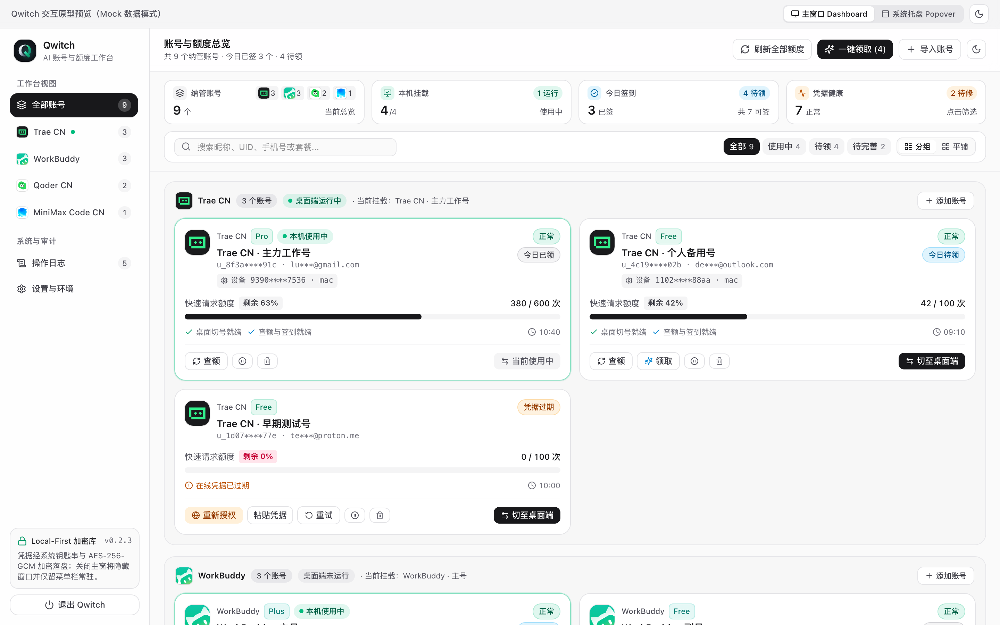
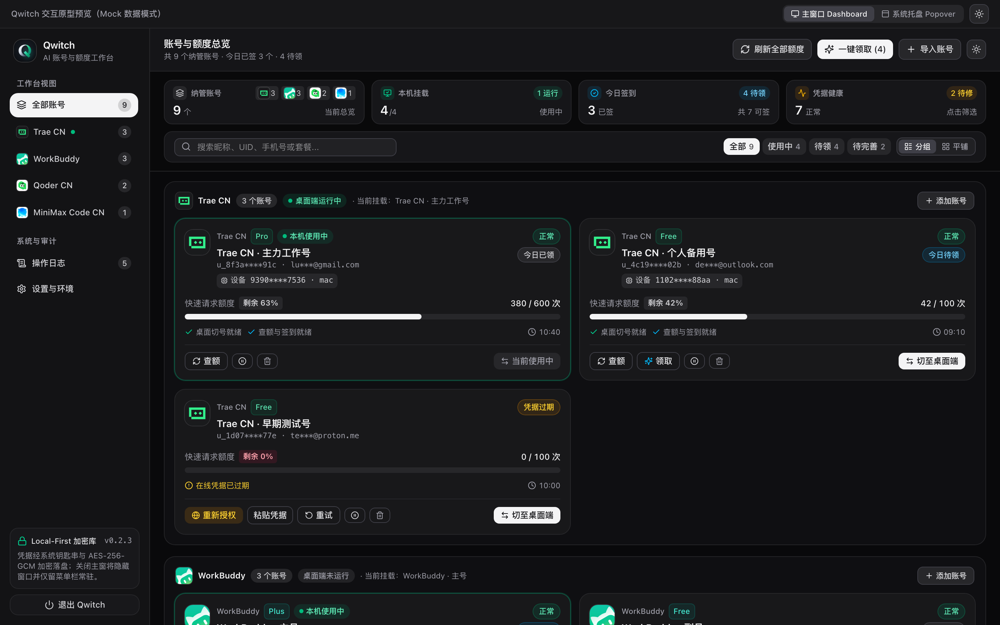
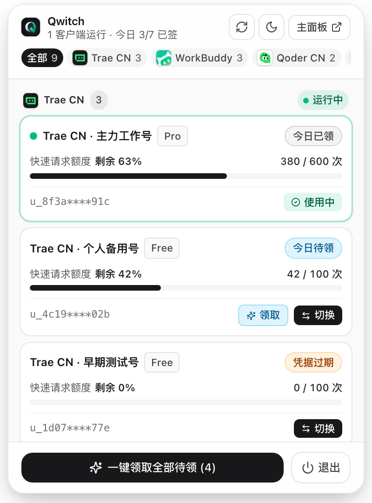
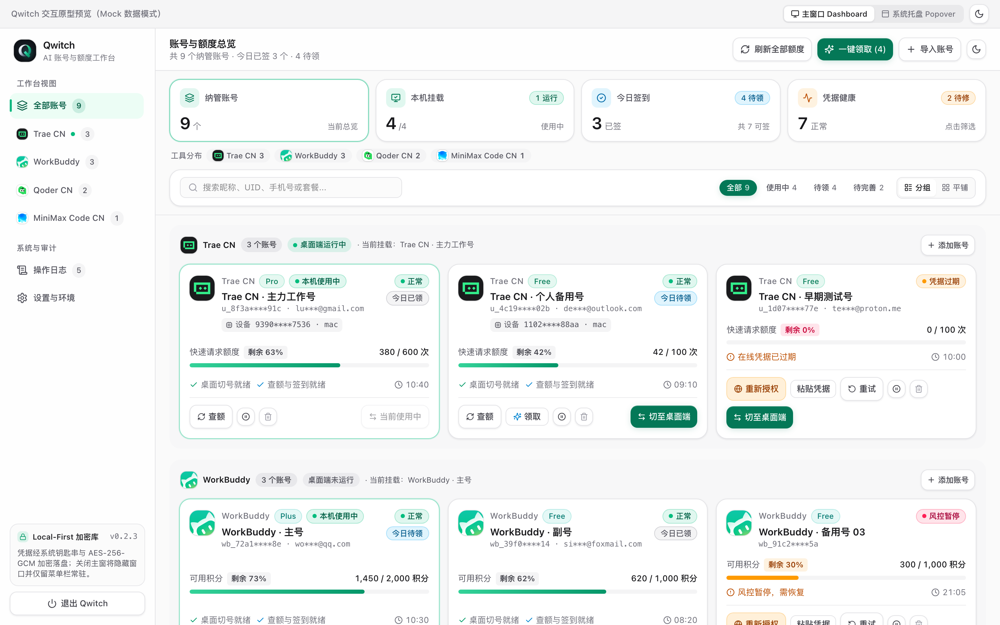
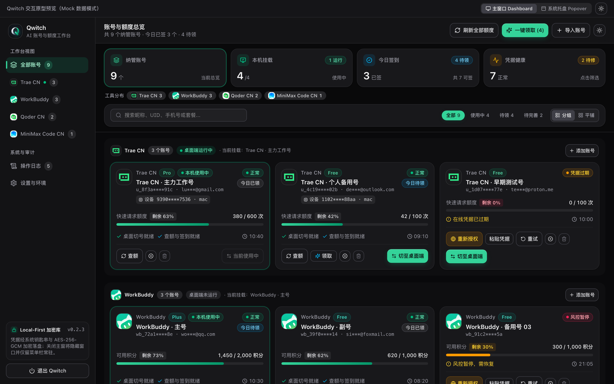

# Qwitch UI 视觉质感优化报告（设计与实现基线）

> **范围**：本轮为**纯视觉层重构**，不改变任何核心功能、数据口径、交互流程与可访问性语义。
> **方法**：逐行核验 `src/` 前端源码 + 在 Tauri 真实窗口尺寸（主窗 1080×740 / 最小 860×580，托盘 384×500）下用 CDP 实测渲染结果，浅色/深色双主题取证。
> **对齐关系**：本轮直接落地 [优化路线图](./OPTIMIZATION_ROADMAP.md) Sprint 3 的 **FE-3.1**（`index.css` 建立 `@theme` 设计令牌，抽取 Button / Card / Badge / Progress / Modal / ConfirmDialog / Toast，补齐 `focus-visible`），并修复 [前端体验审计报告](./FRONTEND_UX_AUDIT.md) 记录的「统计卡在 860–934px 破版」在**布局层**的根因。
> **品牌依据**：[品牌定位与命名规范](./BRAND_IDENTITY.md) —— 气质为「克制、精准、本地可控、安全可信」，故本轮不走花哨路线，走「精密仪表盘」方向。

---

## 一、结论速览

### 视觉对照

| 主窗口（浅色） | 主窗口（深色） | 系统托盘 |
|---|---|---|
|  |  |  |
|  |  |  |

（`*.before.png` 为本轮改动前的原始渲染，作为对照留存。）

### 量化对比

| 维度 | 优化前 | 优化后 |
|---|---|---|
| 设计令牌 | `index.css` 仅 31 行，无颜色/阴影/字体令牌 | 519 行，含 `brand-*` 色阶、圆角/阴影/字体/动效刻度 + 12 个共享组件类 |
| 主按钮写法 | 5 种硬编码写法，`bg-zinc-900` 出现 **98 次** | 统一 `.btn-primary`（品牌色实心 + 内高光） |
| 圆角取值 | 8 种（lg/xl/full/md/2xl + 3 个任意值） | 4 档刻度：`--radius-card` / `--radius-control` / `--radius-inner` / `--radius-pill` |
| 次要文字 | `text-[11px]` 出现 **118 次** | 降至 **48 次**（-59%），可读文字提升至 `text-xs` |
| 阴影 | 仅 `shadow-2xs` / `shadow-xs`（几乎不可见） | 4 档 elevation：`shadow-card` / `shadow-card-hover` / `shadow-float` / `shadow-brand` |
| 品牌一致性 | Logo 是翡翠绿→青绿，界面主色是**纯黑** | 主色统一为 `brand-*`（与 Logo 同源），进度条/选中态/主按钮全线品牌化 |

---

## 二、影响视觉质感的主要问题（按优先级）

### P0-1｜没有设计体系，全站「通用后台模板感」

`src/index.css` 原本只有 31 行，仅定义 3 个 radius 变量；颜色、阴影、字体、动效全部散落在 JSX 的 Tailwind 字符串里。结果是：

- 主色是 Tailwind 默认 `zinc-900` **纯黑**，而 Qwitch Logo 是翡翠绿→青绿渐变 —— 品牌资产与界面完全脱钩，识别度低。
- 每个按钮、徽标、卡片各写一套 class，样式语言随写随变，没有可继承的基准。
- 换肤/改色需逐文件搜索替换，无法作为体系维护。

### P0-2｜层级靠「描边堆叠」而非留白与字重

主窗口存在 **5 层同权重的 1px 边框**：侧栏 → 分组 section → 账号卡片 → 额度行 → 进度条轨道。每层边框都画在同一条视觉基准上，眼睛无法分辨主次，整体呈现「线框堆叠」的廉价感，而不是纵深。

### P0-3｜响应式断点基准错位 —— 最小窗口宽度下真实破版

KPI 区原写法为 `grid-cols-2 sm:grid-cols-4`。`sm` = 640px 是**视口**宽度，但主窗口有 224px 固定侧栏（`tauri.conf.json` `minWidth: 860`）：

```
860px 窗口 → 内容区 636px → 却切成 4 列 → 每列约 147px
→ 标签被截断为「本机…」「凭据…」「今日…」
```

这是 `docs/FRONTEND_UX_AUDIT.md` 中「统计卡在 860–934px 破版」的**根因**：断点基准用错了参照物（视口 vs 内容区）。同理，账号卡片网格的 `md:grid-cols-2 2xl:grid-cols-3` 也存在同样的错位。

### P0-4｜缺少共享组件基元

按钮有 5 种以上互不相同的写法（`bg-zinc-900`、`bg-zinc-100 dark:bg-zinc-100`、`border+bg-white`、`bg-amber-600`、`bg-sky-500`…），徽标、卡片、芯片同理。同一语义在不同页面呈现不同，是「不够精致」最直接的来源。

### P1-1｜语义色与品牌色无规则混用

额度进度条用**纯黑** `bg-zinc-900`，与「低额度红条 / 中等黄条」处在同一视觉权重上。黑色是最重的颜色，却被用来表示「正常」，导致真正需要预警的状态反而被淹没。

### P1-2｜字号刻度倒挂

`text-[11px]` 出现 118 次，成为事实上的默认字号；而 KPI 主数字仅 `text-lg`。标题与正文的对比不足，长列表扫读困难。

### P1-3｜图标细节不统一

- lucide 图标尺寸在 `h-3` 与 `h-3.5` 之间随意切换；
- 品牌图标容器 `xs` 档用 `rounded-[4px]`，小尺寸下圆角过尖，是典型的「廉价感」来源；
- 缺少统一描边与光学对齐策略。

### P1-4｜交互反馈偏弱

- hover 普遍只有背景色变化，无位移/阴影反馈，卡片「浮不起来」；
- 按钮无 `active` 按压态；
- 骨架屏是纯 `animate-pulse` 呼吸，无微光扫过；
- 焦点环用的是浏览器默认的 sky-500，与品牌色不符。

### P1-5｜托盘筛选条横向溢出无提示

384px 托盘内工具筛选条 `overflow-x-auto`，右侧 chip 被**硬切**（如「Qoder CN 2」），没有任何渐隐或可滚动提示，用户不知道还能横向滑动。

### P2-1｜滚动条未定义样式

macOS 默认粗滚动条会破坏「精密仪表盘」的观感。

---

## 三、本轮已落地的改动（按优先级）

### 3.1 建立设计令牌层（`src/index.css`，P0-1）

新增 `@theme` 令牌：`brand-50…950`（与 Logo 同源的翡翠绿→青绿）、圆角 4 档、阴影 4 档、`--font-sans`（补齐 PingFang SC / 微软雅黑 / Noto Sans SC 回退）、`--ease-soft` 缓动、3 个关键帧动画。

同时在 `@layer base` 统一：全局 `tabular-nums`（数据对齐）、品牌色 `focus-visible` 焦点环、`::selection`、细滚动条（`scrollbar-width: thin` + WebKit 定制）。

### 3.2 抽取共享组件基元（P0-4 / P1-3）

| 基元 | 说明 |
|---|---|
| `.btn` + `.btn-xs/.btn-sm/.btn-md/.btn-icon` | 尺寸刻度（图标按钮用 `.btn-icon` 保持正方形） |
| `.btn-primary / .btn-secondary / .btn-ghost / .btn-danger` | 语义变体；主按钮为品牌色实心 + `inset` 内高光，浅色主按钮用 `brand-700`（与白字对比度 5.5:1，达 WCAG AA），深色主按钮用 `brand-400` + `zinc-950` 字（10.4:1） |
| `.surface-card` / `.surface-interactive` | 卡片表面；`surface-interactive` 提供 hover 抬升（`translateY(-1px)` + 阴影加深） |
| `.meter` / `.meter-fill` | 品牌渐变进度条（`brand-400 → brand-600`） |
| `.nav-item` / `.nav-item-active` | 侧栏导航；选中态由「纯黑药丸」改为**品牌浅底 + 左侧 3px 色条** |
| `.chip` / `.chip-active` | 筛选芯片 |
| `.badge` + `.badge-neutral` / `.badge-brand` | 徽标/计数气泡 |
| `.skeleton` | 微光扫过式骨架屏 |
| `.mask-fade-r` / `.scrollbar-none` | 溢出渐隐与隐藏滚动条 |

### 3.3 修正响应式基准（P0-3）—— 本轮最关键的修复

把**视口断点**改为**容器查询**：主内容列加 `@container`，内部网格按**内容区宽度**分档：

```
KPI 区：grid-cols-1 @sm:grid-cols-2 @3xl:grid-cols-4
账号网格：grid-cols-1 @lg:grid-cols-2 @5xl:grid-cols-3
```

（`@sm`=384px、`@lg`=512px、`@3xl`=768px、`@5xl`=1024px，均为内容区宽度）

效果：在最小窗口 860px（内容区 636px）下 KPI 稳定为 2 列，**标签不再截断**；1080px 默认窗口下为 4 列。侧栏宽度同时由 `w-54`(216px) 调整为 `w-56`(224px) 以提升导航可点性。

### 3.4 层级重排（P0-2 / P1-1 / P1-2）

- **取消分组 section 的描边**，改用浅色底 + 更强的标题行，减少一层「框套框」；
- **KPI 区重做**为 4 张 Stat Tile：彩色图标底（brand / emerald / sky / amber）+ `text-2xl` 主数字 + 状态徽标，形成色彩节奏与明确焦点；原本挤在第一张卡里的工具分布移到独立「工具分布」条（带品牌图标）；
- **进度条**由纯黑改为品牌渐变，`rose-500` / `amber-500` / `emerald-500` 的语义色**完整保留**（低额度告警不丢失）；
- **字号**：可读文字由 `text-[11px]` 提升到 `text-xs`（118 → 48 处）；UID/时间戳等等宽元数据保留 11px；
- **徽标**统一 base + 语义色调，状态点（正常/过期/风控/停用）用对应色点区分，弱化时可读性提升。

### 3.5 组件细节与交互反馈（P1-3 / P1-4）

- 品牌图标容器圆角改为随尺寸递增（`rounded-[6px]` → `rounded-2xl`），去掉过尖的 4px；
- 按钮统一 `active` 按压缩放（0.97）、hover/disabled/焦点态统一；
- 卡片 hover 抬升 + 阴影加深；
- 骨架屏改为微光扫过（`.skeleton`）；
- Modal 加 `animate-pop` 弹入 + `shadow-float` + `backdrop-blur-sm` 遮罩；
- Toast 加 `animate-fade-up` 入场 + `shadow-float`；
- 焦点环统一为品牌色 `brand-500`。

### 3.6 托盘溢出可感知性（P1-5）

筛选条加 `mask-fade-r` + `scrollbar-none`：右侧 chip 现在是**渐隐**而非硬切，明确传达「可横向滚动」。同时托盘主按钮（领取/切换/一键领取）统一为品牌色，与主窗口形成同一品牌语言。

---

## 四、后续可落地的改进建议（按优先级）

### P1｜建议尽快跟进

1. **账号卡片的信息密度仍偏高**（`src/components/AccountCard.tsx`）
   一张卡片同时承载：工具名 + 套餐 + 状态徽标 + 标题 + UID + 设备身份 + 额度标签 + 百分比 + 进度条 + 就绪清单 + 时间戳 + 4 个操作按钮。
   *建议*：把「桌面切号就绪 / 查额与签到就绪」这类**始终成功**的就绪清单降级为 hover 提示或仅在异常时展示；设备身份 chip 移到 hover 详情；把 `Pro / Free` 套餐与工具名合并为一行「Trae CN · Pro」，消除「Trae CN」在同一张卡里出现两次。

2. **KPI 数字缺少语义化的迷你可视化**
   *建议*：4 张 Stat Tile 增加 1px 微型 meter（如「今日签到」下方一条 `claimed/eligible` 进度条），让「3 已签 / 共 7 可签」一眼可读，而不只是两个数字。

3. **托盘卡片重复了主窗口的完整信息**
   *建议*：托盘只保留「工具 + 账号名 + 剩余额度 + 一个主动作」，把「设备 / 就绪清单 / 套餐」折叠为一行 tooltip，可让托盘一屏显示更多账号。

### P2｜可择期跟进

4. **图标体系收口**：统一 lucide 图标尺寸为 14px（内联）/ 16px（独立按钮）/ 12px（徽标内），并核对描边宽度在浅/深两种背景下的光学一致性。
5. **品牌 Logo 的深色表现**：`QwitchLogo` 固定 `bg-[#0B0D11]`，在深色侧栏（`zinc-900`）中对比偏弱，可考虑深色模式下加一圈 `ring-white/15` 或提亮底色。
6. **空态与首屏引导**：空账号态目前只有文字 + 两个按钮，可加入插画/图标组合与「三步导入」流程说明。
7. **动效预算**：为列表增删加 `animate-fade-up` 过渡，但需设定统一时长上限（建议 200–280ms），避免多处动效叠加造成拖沓。
8. **减少 `text-[11px]` 残留**（当前 48 处）：可用 `text-label-xs` 令牌替换魔法数字，保留可调空间。

### P3｜工程化

9. **把 `.btn-*` 等基元抽成 React 组件**（`<Button variant="primary" size="sm">`），在类名之外再提供类型约束；当前是「纯 CSS 基元 + 字符串拼接」，可维护性已足够，但易写错组合。
10. **`qwitch/` 目录**：仓库根存在一个未跟踪的 `qwitch/` 副本目录（与 `src/` 内容已产生差异），疑似历史遗留，建议确认后清理或加入 `.gitignore`，避免误提交。

---

## 五、验证结果

| 检查项 | 结果 |
|---|---|
| `npx tsc --noEmit` | ✅ 通过，无错误 |
| `npx vitest run` | ✅ **32 个测试文件 / 132 个用例全部通过** |
| `npm run build` | ✅ 通过（JS 346.63 kB / gzip 96.48 kB，CSS 86.20 kB / gzip 13.00 kB） |
| 浅色主题 1080×740 | ✅ 实测渲染，KPI 4 列无截断 |
| 深色主题 1080×740 | ✅ 实测渲染，品牌主按钮/进度条/选中态一致 |
| 托盘 384×500 | ✅ 实测渲染，chip 渐隐提示生效，无横向溢出破版 |
| 日志 / 设置视图 | ✅ 实测渲染，与主窗口同一套视觉语言 |
| 行为回归 | ✅ 无：所有 `onClick` / `disabled` / `aria-*` / `role` / `title` / 文案 / 数据口径均未改动，仅替换 className |

---

## 六、维护指引

- **新增按钮**：用 `.btn .btn-sm .btn-secondary` 这类组合，不要再手写 `bg-zinc-900`；
- **新增卡片**：用 `.surface-card`，可交互的加 `.surface-interactive`；
- **新增进度条**：用 `.meter` + `.meter-fill`；若颜色代表语义（低额度告警等），保留显式语义色类；
- **新增徽标**：用 `.badge` + 语义色；
- **断点**：主内容区内的布局一律用 `@container` 查询（`@sm` / `@lg` / `@3xl` …），不要用 `sm:` / `md:` 等视口断点——主窗口有固定侧栏，视口宽度不等于内容区宽度；
- **暗色适配**：`.surface-card` / `.btn-*` / `.chip` / `.badge` 已内置暗色规则，业务代码尽量不要再手写 `dark:` 覆盖，除非确有语义需要。
